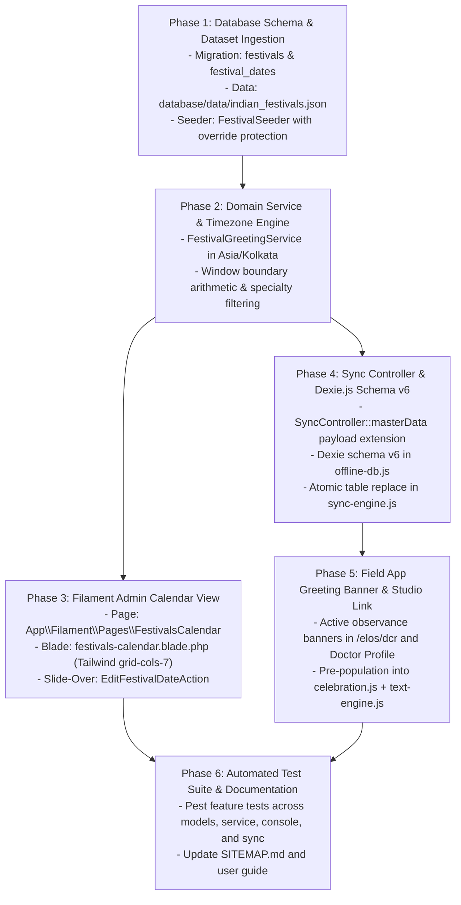

# Centralized Indian Festival & Healthcare Observance Calendar Engine

* **Author:** Exponit Labs Engineering Team
* **Status:** Draft
* **Date:** 2026-11-03

---

## Overview

The Centralized Indian Festival & Healthcare Observance Calendar Engine equips Exponit Labs with an authoritative, database-backed calendar system to manage major Indian cultural festivals, national holidays, and healthcare observances across 2025–2030.

Rather than recording sensitive personal doctor attributes (such as religion or community), the system approaches relationship-building through an objective, calendar-driven greeting engine. Administrators maintain and adjust festival dates centrally within a month-by-month calendar grid in the Filament admin console (`/console/festivals`), enabling real-time adjustments for astronomical moon sightings (such as Eid-ul-Fitr and Eid-ul-Adha) and regional notifications.

In the offline-first field app used by Medical Representatives (`/elos`), active greeting windows automatically highlight upcoming observances without requiring continuous network connectivity, connecting directly into the existing celebration card canvas and festive text generation engine.

---

## The Problem

Medical Representatives (MRs) rely on timely personal touchpoints—such as festival greetings and healthcare day recognitions—to build strong professional rapport with doctors. In the current workflow, reps face three distinct operational hurdles:

1. **Absence of Centralized Calendar Awareness**: Reps have no structured calendar awareness inside the field app. They either miss key dates or depend on ad-hoc WhatsApp forwards, which degrades the company's brand presence.
2. **Privacy, Compliance, and Ethical Liabilities of Religious Profiling**: Storing doctor religious affiliations or community tags creates severe data privacy exposure under India's Digital Personal Data Protection (DPDP) Act, alongside brand sensitivity risks. Relationship outreach must be calendar-driven and professional, not profile-driven.
3. **Lunisolar Date Shifts**: Key Indian observances follow lunisolar calendars (e.g., Eid-ul-Fitr, Eid-ul-Adha, Diwali, Holi) whose exact dates shift based on moon sightings and state gazette notifications. A hardcoded, static calendar quickly becomes incorrect without administrative date adjustment tooling.
4. **Clinical Specialty Relevance**: While national celebrations (such as Republic Day or National Doctor's Day on July 1) apply universally, clinical observances (such as World Heart Day or World Glaucoma Day) must be targeted. Sending clinical greeting cards to unrelated specialists harms field rep credibility.

---

## Goals

* **Pre-bundled Multi-Year Dataset**: Ingest a verified, static dataset of Indian national holidays, major cultural festivals, and healthcare observances for 2025–2030 derived from official Government of India (DoPT) Gazetted orders, IMD Rashtriya Panchang, and the Indian Medical Association (IMA).
* **Central Administrative Calendar (`/console/festivals`)**: Provide a responsive monthly grid in the Filament console allowing administrators to inspect all scheduled observances and update dates via slide-over actions.
* **Override Protection**: Protect manual date overrides (`is_manually_adjusted = true`) so that future deployments or automated database seeders never overwrite real-world adjustments.
* **Deterministic Active Window Engine**: Define clean date window arithmetic in Indian Standard Time (`Asia/Kolkata`): an observance on date $D$ is active on target date $T$ when $(D - \text{days\_before}) \le T \le (D + \text{days\_after})$.
* **Offline Master Data Synchronization**: Deliver calendar updates to the `/elos` mobile field app via atomic table replacement in IndexedDB (Dexie schema v6), avoiding sliding-window sync invalidation.
* **Direct Reuse of Existing Graphics & Text Assets**: Surface contextual festival banners in `/elos/dcr` and doctor profiles that open the existing Call Reminder Studio modal with the `celebration.js` canvas template pre-selected and festive greeting copy pre-populated.
* **Specialty Targeting for Clinical Days**: Allow clinical observances to restrict visibility to matching physician specialties, while keeping cultural and national holidays universal.

---

## Non-Goals

* **Doctor Religious or Community Profiling**: Strictly excluded. No religion, community, or caste attributes will ever be stored in the database or doctor records.
* **Building a New Canvas or Graphic Rendering Pipeline**: Strictly deferred. The feature will directly reuse the existing 1080x1080 canvas engine in `resources/js/reminder-cards/celebration.js` and copy templates in `resources/js/reminder-cards/text-engine.js`.
* **Client-Side or Server-Side Video Generation**: Strictly excluded from Phase 1.
* **Automated WhatsApp Broadcasting / Push Bots**: Strictly rep-initiated. Greeting cards are shared via rep-reviewed WhatsApp click-to-chat links (`wa.me`) to protect against WhatsApp business spam restrictions and maintain genuine rep-doctor rapport.
* **Third-Party Calendar JS Bloat**: No heavy external JavaScript calendar libraries (such as FullCalendar) will be embedded in the Filament console.

---

## Open Questions

* **Regional State Gazette Variations**: Certain regional festivals (e.g., Onam in Kerala, Chhath Puja in Bihar/UP, Durga Puja in West Bengal) are celebrated primarily in specific states. The current specification treats all bundled festivals as nationally visible. Should an optional `state_id` filter be added in a future phase if state-level divisions expand?
  * *Status*: Documented for Phase 2 consideration. Multi-state accounts currently operate under unified national schedules.

---

## Critical User Journeys (CUJs)

### CUJ 1: Central Admin Modifies a Festival Date on Moon Sighting
* **Given**: An administrator is logged into the Filament console at `/console/festivals`. Eid-ul-Fitr is scheduled for March 31, 2025, but the moon sighting confirms the holiday is officially April 1, 2025.
* **When**: The administrator navigates to March 2025, clicks the Eid-ul-Fitr card badge, modifies the date to `2025-04-01`, and clicks Save.
* **Then**: The record in `festival_dates` updates to `2025-04-01`, sets `is_manually_adjusted = true`, and logs the admin user ID. Subsequent database seed runs preserve the adjusted date.

### CUJ 2: Medical Representative Shares a Cultural Festival Greeting Offline
* **Given**: A Medical Representative is working offline in `/elos` on November 1, 2025. Diwali is on November 1, with `days_before = 3` and `days_after = 1`.
* **When**: The rep opens a doctor's profile or the Daily Call Report (`/elos/dcr`).
* **Then**: An "Active Observance: Diwali" banner appears. Tapping "Create Greeting" opens the Call Reminder Studio with the doctor's name, the `celebration` canvas card template selected, and Diwali greeting text pre-filled. The rep generates the card and taps "Share on WhatsApp".

### CUJ 3: Specialty-Filtered Clinical Health Day Display
* **Given**: September 29 is World Heart Day, configured with `category = clinical_observance` and `target_specialties = ["Cardiology", "Internal Medicine"]`.
* **When**: An MR views a Cardiologist's profile in `/elos`.
* **Then**: The World Heart Day observance banner is visible. If the rep subsequently opens an Orthopedic Surgeon's profile, the World Heart Day banner remains hidden.


---

## Technical Plan (Architecture)

### 1. High-Level System Architecture

The observance engine operates across three synchronized tiers: authoritative static data seeding, centralized administrative date management via Filament v5, and offline-first client evaluation in the `/elos` field app.

```mermaid
flowchart TD
    subgraph Data Tier
        JSON["database/data/indian_festivals.json<br/>(2025–2030 Verified Baseline)"] -->|Initial Seed / Artisan Command| Seeder["FestivalSeeder<br/>(Skips is_manually_adjusted=true)"]
        Seeder --> DB_Festivals["festivals Table<br/>(Metadata, Categories, Defaults)"]
        Seeder --> DB_Dates["festival_dates Table<br/>(Dates, Year, Overrides)"]
    end

    subgraph Central Console [Filament v5]
        Admin["Administrator"] -->|Visits /console/festivals| LivewireGrid["App\\Filament\\Pages\\FestivalsCalendar<br/>(Native Tailwind grid-cols-7 Month Grid)"]
        LivewireGrid -->|Slide-Over Edit Action| EditDateAction["EditFestivalDateAction<br/>(Sets is_manually_adjusted = true)"]
        EditDateAction --> DB_Dates
    end

    subgraph Sync Tier [REST API]
        DB_Dates & DB_Festivals --> Service["FestivalGreetingService<br/>(Calculates Windows in Asia/Kolkata)"]
        Service --> SyncController["SyncController::masterData<br/>(Decoupled from ?since timestamp)"]
    end

    subgraph Field Tier [/elos Mobile App]
        SyncController -->|Atomic clear & bulkPut| Dexie["Dexie.js Schema v6<br/>(upcoming_festivals Table)"]
        Dexie --> WindowEngine["Festival Window Evaluator<br/>(today >= window_start && today <= window_end)"]
        WindowEngine --> DCRBanner["/elos/dcr Active Banner"]
        WindowEngine --> ProfileBanner["Doctor Profile Observance Card"]
        ProfileBanner -->|Tap 'Create Greeting'| ReminderStudio["Call Reminder Studio Modal<br/>(celebration.js + text-engine.js)"]
        ReminderStudio --> WhatsApp["Rep-Reviewed WhatsApp Click-to-Chat (wa.me)"]
    end
```

---

### 2. Database Schema & Data Models

The persistence layer separates festival taxonomy from yearly calendar instances.

#### Table: `festivals`
Stores the metadata, categorization, copy templates, and window duration defaults.

| Column | Type | Constraints / Modifiers | Description |
| :--- | :--- | :--- | :--- |
| `id` | `unsignedBigInteger` | `PK`, `auto_increment` | Primary key |
| `name` | `string` | `not null` | Display name (e.g., "Diwali", "Eid-ul-Fitr", "World Heart Day") |
| `slug` | `string` | `unique`, `not null` | Kebab-case URL identifier (e.g., `diwali`, `world-heart-day`) |
| `category` | `string` | `not null`, default: `'cultural_and_national'` | Either `'cultural_and_national'` or `'clinical_observance'` |
| `target_specialties` | `json` | `nullable` | Specialty tags for clinical filtering (e.g. `["Cardiology", "Internal Medicine"]`). Null for universal. |
| `days_before` | `unsignedTinyInteger` | `not null`, default: `3` | Number of days prior to the date when the greeting window opens |
| `days_after` | `unsignedTinyInteger` | `not null`, default: `1` | Number of days after the date when the greeting window closes |
| `card_template_key` | `string` | `not null`, default: `'celebration'` | Template key binding to client-side `resources/js/reminder-cards/celebration.js` |
| `greeting_message_template`| `text` | `nullable` | Pre-configured festive greeting copy template |
| `is_active` | `boolean` | `not null`, default: `true` | Soft toggle to deactivate an observance organization-wide |
| `timestamps` | `timestamp` | `nullable` | `created_at` and `updated_at` |

#### Table: `festival_dates`
Stores specific calendar occurrences per year with manual adjustment tracking.

| Column | Type | Constraints / Modifiers | Description |
| :--- | :--- | :--- | :--- |
| `id` | `unsignedBigInteger` | `PK`, `auto_increment` | Primary key |
| `festival_id` | `unsignedBigInteger` | `FK` -> `festivals.id`, `cascadeOnDelete` | Parent festival reference |
| `year` | `unsignedSmallInteger` | `not null` | Gregorian calendar year (e.g., `2025`, `2026`) |
| `date` | `date` | `not null` | Exact calendar date (`YYYY-MM-DD`) |
| `is_manually_adjusted` | `boolean` | `not null`, default: `false` | Prevents automated seeders from overwriting admin modifications |
| `adjusted_by_user_id`| `unsignedBigInteger` | `FK` -> `users.id`, `nullable`, `nullOnDelete` | Audit user ID who adjusted the date |
| `adjustment_notes` | `string` | `nullable` | Reason for shift (e.g., "Confirmed Delhi Hilal Committee moon sighting") |
| `timestamps` | `timestamp` | `nullable` | `created_at` and `updated_at` |

**Indexes**:
* `unique(['festival_id', 'year'], 'idx_festival_year_unique')`: Guarantees one canonical date per festival per Gregorian year.
* `index(['date', 'festival_id'], 'idx_festival_date_lookup')`: Optimizes date-range scans for monthly calendar grids and sync payloads.

---

### 3. Central Administrative Calendar View (`/console/festivals`)

Rather than relying on third-party calendar packages, the calendar UI is implemented as a custom Filament Page (`App\Filament\Pages\FestivalsCalendar`) with a native Livewire 4 component and Tailwind CSS 7-column grid (`grid-cols-7`).

#### UX & Component Architecture
* **Header & Controls**:
  * Month / Year stepper controls: `Previous Month`, `Today`, `Next Month`.
  * Category toggle filters: `All`, `Cultural & National`, `Clinical Observance`.
  * Indian Standard Time (`Asia/Kolkata`) header badge.
* **Month Grid Layout**:
  * Standard 7-column header: `Mon`, `Tue`, `Wed`, `Thu`, `Fri`, `Sat`, `Sun`.
  * Day cells rendered with date number, current-day indicator ring, and badges for observances occurring on that date.
  * Observance badges color-coded by category:
    * `cultural_and_national`: Emerald / Green (`bg-emerald-50 text-emerald-700 border-emerald-200`)
    * `clinical_observance`: Sky / Blue (`bg-sky-50 text-sky-700 border-sky-200`)
  * Manual override indicator icon (`Heroicon::Sparkles` or `Heroicon::AdjustmentsHorizontal`) shown when `is_manually_adjusted === true`.
* **Date Adjustment Action (`EditFestivalDateAction`)**:
  * Clicking an observance badge triggers a standard Filament modal or slide-over action.
  * Form fields:
    * `date`: DatePicker (constrained to the selected year, formatted as `YYYY-MM-DD`).
    * `adjustment_notes`: TextInput (e.g., "Moon sighting confirmed for April 1st").
  * On save:
    * Updates `festival_dates.date`.
    * Sets `is_manually_adjusted = true`.
    * Sets `adjusted_by_user_id = auth()->id()`.
    * Emits standard Filament notification: `"Festival date updated successfully."`.

---

### 4. Active Greeting Window Calculation & Timezone Invariant

#### Calculation Formula
An observance date $D$ is deemed active on evaluation date $T$ if:
$$D - \text{days\_before} \le T \le D + \text{days\_after}$$

For instance, for Diwali on **November 1, 2025** with `days_before = 3` and `days_after = 1`:
* Window Start: `2025-10-29`
* Observance Date: `2025-11-01`
* Window End: `2025-11-02`

#### Timezone Invariant
All backend window calculations and database queries must anchor to Indian Standard Time (`Asia/Kolkata`, UTC+05:30):
```php
$today = Carbon::now('Asia/Kolkata')->startOfDay();
```
This guarantees that midnight rollover occurs identically across both the server and reps' physical mobile devices across India, avoiding the 5.5-hour UTC lag.

---

### 5. Offline Master Data Sync & Dexie.js Schema Upgrade (v6)

#### Sync Invalidation Trap & Resolution
The standard `SyncController::masterData` uses `?since=<last_synced_at>` to perform incremental delta updates. Because pre-seeded calendar records for 2025–2030 have static historical `created_at` and `updated_at` timestamps, querying festivals by `updated_at >= $since` fails to serve upcoming observances as time progresses.

**Resolution Protocol**:
1. Decouple festival payload from the `?since` timestamp constraint.
2. In `SyncController::masterData`, always return the active dataset (current year + next year, approximately 80 records, < 10 KB JSON).
3. Compute `window_start` and `window_end` strings directly in the server payload.
4. The client sync engine (`resources/js/sync-engine.js`) handles the `festivals` payload via an atomic clear-and-replace in IndexedDB:
   ```javascript
   if (data.festivals && Array.isArray(data.festivals)) {
       await db.upcoming_festivals.clear();
       await db.upcoming_festivals.bulkPut(data.festivals);
   }
   ```

#### Dexie.js Schema Version 6 (`resources/js/offline-db.js`)
Upgrade the client database schema from version 5 to version 6:
```javascript
db.version(6).stores({
    // Preserved existing stores...
    doctors: 'id, name, status, area_id, doctor_potential_id',
    // New festival store:
    upcoming_festivals: 'id, festival_id, category, date, window_start, window_end'
});
```

---

### 6. Field App Awareness & Call Reminder Studio Integration

#### Contextual Observance Banners
1. **Daily Call Report View (`/elos/dcr`)**:
   * Evaluates `db.upcoming_festivals` against local Indian date string (`todayStr`).
   * If any cultural/national festival is active, displays a dismissible banner at the top of the DCR:
     > 🪔 **Active Observance**: Diwali (Nov 1) — Tap to view greeting templates.
2. **Doctor Profile Page (`doctor-profile.blade.php`)**:
   * Checks both cultural/national observances and specialty-matched clinical observances:
     ```javascript
     const activeObservances = await db.upcoming_festivals
         .filter(f => {
             const inWindow = todayStr >= f.window_start && todayStr <= f.window_end;
             if (!inWindow) return false;
             if (f.category === 'cultural_and_national') return true;
             return !f.target_specialties || f.target_specialties.length === 0 || f.target_specialties.includes(currentDoctor.specialty);
         })
         .toArray();
     ```
   * Surfaces an inline banner above visit history:
     > 🩺 **World Heart Day Observance Window Active (Sep 29)**  
     > [Create Greeting Card]

#### Call Reminder Studio Modal Integration
Clicking **[Create Greeting Card]** dispatches an event opening the existing `mr.components.call-reminder-modal` with pre-filled state:
* `cardTemplate`: `'celebration'` (pointing directly to `resources/js/reminder-cards/celebration.js`)
* `doctorName`: `currentDoctor.name`
* `greetingMessage`: `observance.greeting_message || "Wishing you a happy and prosperous [Festival Name]!"`
* The client-side HTML5 canvas immediately renders the 1080x1080 graphic.
* The rep taps **Share on WhatsApp**, which constructs a `https://wa.me/?text=...` URI with the personalized greeting.


---

## Alternatives Considered

### Alternative 1: Storing Doctor Religion & Community Attributes (`doctors.religion`)
* **Approach**: Adding an enum or string `religion` column (`hindu`, `muslim`, `christian`, `sikh`, etc.) to the `doctors` table and restricting greeting templates strictly to matched profiles.
* **Pros**:
  * Would technically allow algorithmic filtering based on assumed religious identity.
* **Cons**:
  * Severe data protection liability under India's Digital Personal Data Protection (DPDP) Act, which strictly penalizes unauthorized collection and processing of sensitive personal data.
  * Operationally brittle: forces Medical Representatives into invasive, awkward questioning or inaccurate guessing of doctor backgrounds.
  * High risk of cultural offense when reps make incorrect assumptions.
  * Ignores the reality of Indian professional culture, where major national celebrations (Diwali, Eid, Christmas, Republic Day, Independence Day, National Doctor's Day) are exchanged universally across communities.
* **Reason for Rejection**: Storing religion is legally precarious, ethically sensitive, and operationally counterproductive. A calendar-driven, objective observance engine enables authentic relationship-building with zero compliance risk.

---

### Alternative 2: Third-Party Calendar Plugins (FullCalendar.js / NPM Wrappers)
* **Approach**: Embedding an external JavaScript calendar package (e.g., FullCalendar, Toast UI Calendar) inside the Filament admin console.
* **Pros**:
  * Out-of-the-box month, week, and day views with interactive drag-and-drop mechanics.
* **Cons**:
  * Incurs significant JavaScript bundle bloat (>300 KB uncompressed assets).
  * High risk of styling and runtime conflicts with Livewire 4, Alpine.js 3, and Tailwind CSS v4 in Filament v5.
  * Fragile across future Filament version upgrades.
  * Over-engineered for a workflow that only requires monthly date visualization and occasional date editing.
* **Reason for Rejection**: A native Livewire 4 Blade component styled with a clean Tailwind 7-column grid (`grid-cols-7`) provides complete design harmony, zero external package dependencies, instant page rendering, and long-term architectural stability.

---

### Alternative 3: Incremental Delta Synchronization (`?since`) with Dynamic Sliding Window
* **Approach**: Querying `festival_dates` using `updated_at >= $since` restricted to a rolling 60-day window (`BETWEEN today AND today + 60 days`) on the server.
* **Pros**:
  * Follows the existing incremental pattern used for transaction tables (e.g., `dcrs`, `doctor_revenues`).
* **Cons**:
  * **The Sliding Window Trap**: Pre-seeded multi-year festival rows have static historical timestamps. As real-world time advances, an upcoming festival entering the 60-day horizon will have an `updated_at` older than `$since` and will be silently ignored by the sync query. Field devices will miss upcoming observances entirely.
  * Ghost records: When an observance date passes or is cancelled, incremental `bulkPut()` leaves expired records stranded in client IndexedDB.
* **Reason for Rejection**: The festival dataset for 2 active years is tiny (~80 records, < 10 KB uncompressed JSON). Decoupling festivals from `?since` and executing an atomic IndexedDB clear-and-replace (`db.upcoming_festivals.clear() + bulkPut()`) eliminates all cache invalidation bugs with negligible network cost.

---

### Alternative 4: Dynamic Runtime Third-Party Holiday APIs (e.g., Calendarific, Nager.Date)
* **Approach**: Integrating an external public holiday API to dynamically query festival dates over HTTP.
* **Pros**:
  * Offloads calendar compilation to an external SaaS vendor.
* **Cons**:
  * Introduces external network failure points, API latency, and vendor lock-in.
  * Commercial API costs and rate limiting.
  * Public international APIs frequently miscalculate Indian lunisolar holidays (e.g., specific regional tithis) and completely lack specialized Indian healthcare days (e.g., National Doctor's Day on July 1, Ayush observances).
  * Cannot function in offline environments or air-gapped test suites.
* **Reason for Rejection**: Pre-bundling verified multi-year JSON derived from official Government of India (DoPT) Gazetted orders and the Indian Medical Association (IMA) guarantees 100% offline autonomy, zero recurring costs, and predictable testability, with the Filament admin UI handling real-world moon sightings.

---

### Alternative 5: Automated WhatsApp Bot Broadcasts
* **Approach**: Triggering automated WhatsApp Business API background jobs to dispatch greeting messages directly to doctors at midnight.
* **Pros**:
  * Eliminates rep effort.
* **Cons**:
  * Doctors view automated corporate broadcast greetings as spam, resulting in high unsubscribe and blocking rates.
  * Serious risk of WhatsApp business account suspension for bulk promotional messaging under Meta business policies.
  * Deprives the field rep of the opportunity to initiate a personal, human conversation.
* **Reason for Rejection**: Relationship-building in pharmaceutical field sales relies on authentic representative-to-doctor rapport. Greetings must remain rep-initiated via click-to-chat (`wa.me`) or in-person visits.


---

## Detailed Implementation Plan

### 1. Phased Implementation Roadmap

The implementation is partitioned into six discrete, test-driven phases designed for zero regression against existing MR field workflows and 100% test coverage.



---

### 2. Complete File Inventory

| Action | File Path | Rationale & Scope of Changes |
| :--- | :--- | :--- |
| **Create** | `database/migrations/2026_11_03_000001_create_festivals_and_dates_tables.php` | Creates `festivals` and `festival_dates` tables with composite indexes, foreign keys, and audit columns. |
| **Create** | `database/data/indian_festivals.json` | Bundles authoritative 2025–2030 dataset covering cultural, national, and clinical observances with specialty tags. |
| **Create** | `app/Models/Festival.php` | Eloquent model for festival metadata, category enums, specialty arrays, and `hasMany(FestivalDate::class)` relationship. |
| **Create** | `app/Models/FestivalDate.php` | Eloquent model for yearly dates, `is_manually_adjusted` flag, `adjustedBy` relationship, and range scopes. |
| **Create** | `database/seeders/FestivalSeeder.php` | Database seeder that ingests `indian_festivals.json` while strictly preserving rows where `is_manually_adjusted === true`. |
| **Create** | `app/Console/Commands/ImportIndianFestivalsCommand.php` | Artisan command `php artisan festivals:import {--force}` for CLI dataset updates and emergency synchronization. |
| **Create** | `app/Services/FestivalGreetingService.php` | Domain service calculating active greeting windows in `Asia/Kolkata`, month-grid projections, and specialty filtering. |
| **Create** | `app/Filament/Pages/FestivalsCalendar.php` | Custom Filament console page at `/console/festivals` with Livewire 4 month navigation and slide-over date editing actions. |
| **Create** | `resources/views/filament/pages/festivals-calendar.blade.php` | Blade view rendering the responsive Tailwind CSS 7-column calendar grid with observance badges. |
| **Modify** | `app/Http/Controllers/Api/V1/SyncController.php` | Decouples festivals from `?since` filtering to output the full active multi-year dataset with pre-computed window boundaries. |
| **Modify** | `resources/js/offline-db.js` | Bumps Dexie database schema to version 6, declaring the `upcoming_festivals` table and indexes. |
| **Modify** | `resources/js/sync-engine.js` | Adds atomic table replacement (`clear() + bulkPut()`) for `upcoming_festivals` during master data sync. |
| **Modify** | `resources/views/elos/dcr.blade.php` | Adds an active cultural/national observance banner at the top of the Daily Call Report view. |
| **Modify** | `resources/views/components/mr/doctor-profile.blade.php` | Adds active observance badges with specialty filtering and a 1-tap "Create Greeting" button. |
| **Create** | `tests/Feature/FestivalModelTest.php` | Pest tests verifying model relationships, scopes, and `is_manually_adjusted` protection against seeder overwrites. |
| **Create** | `tests/Feature/FestivalGreetingServiceTest.php` | Pest tests verifying window arithmetic boundary conditions ($D - \text{days\_before} \le T \le D + \text{days\_after}$) and timezone offsets. |
| **Create** | `tests/Feature/Filament/FestivalsCalendarTest.php` | Pest tests verifying Filament calendar rendering, month navigation, and the slide-over date editing action. |
| **Create** | `tests/Feature/Api/FestivalSyncTest.php` | Pest tests verifying `SyncController::masterData` returns the complete festival payload regardless of `?since`. |

---

### 3. Detailed Component Specifications

#### Phase 1: Database Schema & Dataset Ingestion
1. **Migration (`create_festivals_and_dates_tables.php`)**:
   * `festivals`:
     * `id`: `bigIncrements`
     * `name`: `string(255)`
     * `slug`: `string(255)->unique()`
     * `category`: `string(50)->default('cultural_and_national')`
     * `target_specialties`: `json()->nullable()`
     * `days_before`: `unsignedTinyInteger()->default(3)`
     * `days_after`: `unsignedTinyInteger()->default(1)`
     * `card_template_key`: `string(50)->default('celebration')`
     * `greeting_message_template`: `text()->nullable()`
     * `is_active`: `boolean()->default(true)`
     * `timestamps()`
   * `festival_dates`:
     * `id`: `bigIncrements`
     * `festival_id`: `foreignId('festival_id')->constrained('festivals')->cascadeOnDelete()`
     * `year`: `unsignedSmallInteger()`
     * `date`: `date()`
     * `is_manually_adjusted`: `boolean()->default(false)`
     * `adjusted_by_user_id`: `foreignId('adjusted_by_user_id')->nullable()->constrained('users')->nullOnDelete()`
     * `adjustment_notes`: `string(255)->nullable()`
     * `timestamps()`
     * Unique: `['festival_id', 'year']`
     * Index: `['date', 'festival_id']`
2. **Authoritative Dataset (`database/data/indian_festivals.json`)**:
   * Pre-bundled array of objects containing verified 2025–2030 dates for:
     * **National Holidays**: Republic Day (Jan 26), Independence Day (Aug 15), Gandhi Jayanti (Oct 2).
     * **Major Cultural Festivals**: Diwali / Deepavali, Eid-ul-Fitr, Eid-ul-Adha (Bakrid), Christmas, Holi, Dussehra (Vijayadashami), Raksha Bandhan, Guru Nanak Jayanti, Ganesh Chaturthi, Makar Sankranti / Pongal, Maha Shivratri, Good Friday, Mahavir Jayanti, Buddha Purnima.
     * **Healthcare & Clinical Observances**: National Doctor's Day (July 1, Universal), National Pharmacist Day (Sep 25), World Health Day (Apr 7), World Heart Day (Sep 29, Cardiology/Internal Medicine), World Diabetes Day (Nov 14, Diabetology/Endocrinology/Internal Medicine), World Cancer Day (Feb 4, Oncology), World Glaucoma Day (Mar 12, Ophthalmology), World Kidney Day (2nd Thursday of March, Nephrology/Urology).
3. **Seeder with Override Protection (`FestivalSeeder.php`)**:
   ```php
   foreach ($dataset as $item) {
       $festival = Festival::updateOrCreate(
           ['slug' => $item['slug']],
           Arr::except($item, ['dates'])
       );

       foreach ($item['dates'] as $dateEntry) {
           $existing = FestivalDate::where('festival_id', $festival->id)
               ->where('year', $dateEntry['year'])
               ->first();

           if ($existing && $existing->is_manually_adjusted) {
               continue; // Preserve admin adjustment
           }

           FestivalDate::updateOrCreate(
               ['festival_id' => $festival->id, 'year' => $dateEntry['year']],
               [
                   'date' => $dateEntry['date'],
                   'is_manually_adjusted' => false,
               ]
           );
       }
   }
   ```

#### Phase 2: Domain Service (`FestivalGreetingService.php`)
1. **Methods**:
   * `getActiveObservancesForDate(?Carbon $evalDate = null, ?string $specialty = null): Collection`:
     * Anchors evaluation date: `$targetDate = $evalDate ? $evalDate->copy()->tz('Asia/Kolkata')->startOfDay() : Carbon::now('Asia/Kolkata')->startOfDay()`.
     * Queries `festival_dates` joining `festivals` where `is_active = true`.
     * Applies window calculation: evaluates raw SQL or collection where `DATE_SUB(festival_dates.date, INTERVAL festivals.days_before DAY) <= $targetDate` AND `DATE_ADD(festival_dates.date, INTERVAL festivals.days_after DAY) >= $targetDate`.
     * Filters by `$specialty`: matches if `target_specialties` is empty/null or contains `$specialty`.
   * `getMonthGridData(int $year, int $month): array`:
     * Generates a 42-cell matrix (Monday-anchored 6 rows x 7 days) for the specified Gregorian month.
     * Attaches matching festival date records and pre-calculated metadata (override status, category badge color).

#### Phase 3: Filament Admin Calendar (`/console/festivals`)
1. **Livewire Component (`FestivalsCalendar.php`)**:
   * URL route: `/console/festivals`.
   * Navigation label: "Festival Calendar", grouped under "Practice & Relations".
   * Properties: `public int $year`, `public int $month`, `public ?string $categoryFilter = null`.
   * Methods:
     * `mount()`: Defaults `$year` and `$month` to `Carbon::now('Asia/Kolkata')`.
     * `nextMonth()`: Advances month, rollover to next year at 12.
     * `previousMonth()`: Decrements month, rollover to previous year at 1.
     * `goToToday()`: Resets to current month and year.
   * Actions:
     * `editDateAction()`: Accepts `$festivalDateId`. Opens a modal slide-over with:
       * `DatePicker::make('date')->required()`
       * `TextInput::make('adjustment_notes')->placeholder('Reason for date shift')`
       * Action handler: updates `date`, sets `is_manually_adjusted = true`, sets `adjusted_by_user_id = auth()->id()`, and notifies user.
2. **Blade Template (`festivals-calendar.blade.php`)**:
   * Uses Tailwind CSS `grid grid-cols-7 gap-px bg-gray-200 dark:bg-gray-700 rounded-lg overflow-hidden`.
   * Days outside the current month rendered with dimmed background (`bg-gray-50/50`).
   * Current day highlighted with an emerald indicator dot or ring.

#### Phase 4: Master Data Sync & Dexie.js Schema Upgrade (v6)
1. **API Endpoint (`SyncController::masterData`)**:
   * Exports `festivals` array:
     ```php
     $currentYear = Carbon::now('Asia/Kolkata')->year;
     $activeDates = FestivalDate::with('festival')
         ->whereIn('year', [$currentYear, $currentYear + 1])
         ->whereHas('festival', fn ($q) => $q->where('is_active', true))
         ->get()
         ->map(fn ($fd) => [
             'id' => $fd->id,
             'festival_id' => $fd->festival_id,
             'name' => $fd->festival->name,
             'slug' => $fd->festival->slug,
             'category' => $fd->festival->category,
             'target_specialties' => $fd->festival->target_specialties,
             'date' => $fd->date->toDateString(),
             'window_start' => $fd->date->copy()->subDays($fd->festival->days_before)->toDateString(),
             'window_end' => $fd->date->copy()->addDays($fd->festival->days_after)->toDateString(),
             'card_template_key' => $fd->festival->card_template_key,
             'greeting_message' => $fd->festival->greeting_message_template,
         ]);
     ```
2. **Dexie.js Upgrade (`resources/js/offline-db.js`)**:
   * Version increment: `db.version(6).stores({ upcoming_festivals: 'id, festival_id, category, date, window_start, window_end' })`.
3. **Sync Engine Atomic Handler (`resources/js/sync-engine.js`)**:
   * Replaces table atomically: `await db.upcoming_festivals.clear(); await db.upcoming_festivals.bulkPut(data.festivals);`.

#### Phase 5: Field App Greeting Awareness & Reminder Studio Integration
1. **Banner Integration (`resources/views/elos/dcr.blade.php`)**:
   * An Alpine.js / Blade component reads `db.upcoming_festivals` against local Indian date.
   * If any cultural or national festival window is active, displays an observance banner prompting greeting creation.
2. **Doctor Profile Observance Banner (`doctor-profile.blade.php`)**:
   * Evaluates active windows matching either `category === 'cultural_and_national'` OR specialty match for `clinical_observance`.
   * Renders action button: `[Create Festive Card]`.
3. **Studio Linkage**:
   * Dispatches Livewire or browser event: `window.dispatchEvent(new CustomEvent('open-call-reminder', { detail: { doctorId: ..., template: 'celebration', greetingText: ... } }))`.
   * Directly uses existing `celebration.js` canvas engine.

---

### 4. Verification & Testing Plan

#### Automated Pest Tests
1. **`FestivalModelTest.php`**:
   * Test relationship: `Festival` has many `FestivalDate` records.
   * Test cascade delete on `Festival`.
   * Test `is_manually_adjusted` flag preservation during seeder execution.
2. **`FestivalGreetingServiceTest.php`**:
   * Test window arithmetic: Observance on Nov 1 with `days_before = 3` and `days_after = 1` is active on Oct 29, Oct 30, Oct 31, Nov 1, and Nov 2, but inactive on Oct 28 and Nov 3.
   * Test specialty filtering: Clinical observance with `['Cardiology']` surfaces for a Cardiologist and is excluded for a Pediatrician.
   * Test timezone boundary: Observance evaluated at 23:59 UTC aligns correctly with Indian Standard Time (`Asia/Kolkata`).
3. **`FestivalsCalendarTest.php`**:
   * Test console page renders successfully at `/console/festivals` for authenticated admin users.
   * Test month navigation advances from December to January of next year.
   * Test `editDateAction` updates `festival_dates.date` and sets `is_manually_adjusted = true`.
4. **`FestivalSyncTest.php`**:
   * Test `GET /api/v1/sync/master-data` contains `festivals` payload.
   * Test payload is returned even when `?since` timestamp is present in the request.

#### Manual Verification Script
1. Log into `/console/festivals` and verify the current month displays scheduled observances.
2. Shift a test festival date (e.g., Eid-ul-Fitr) by 1 day and verify the `is_manually_adjusted` badge appears.
3. Run `php artisan db:seed --class=FestivalSeeder` and verify the modified date is NOT overwritten.
4. Run master data sync in the `/elos` field app and verify IndexedDB table `upcoming_festivals` contains active records.
5. In `/elos`, open a doctor profile during an active observance window and tap "Create Greeting", confirming the `celebration.js` canvas renders the 1080x1080 card with pre-filled greeting text.
