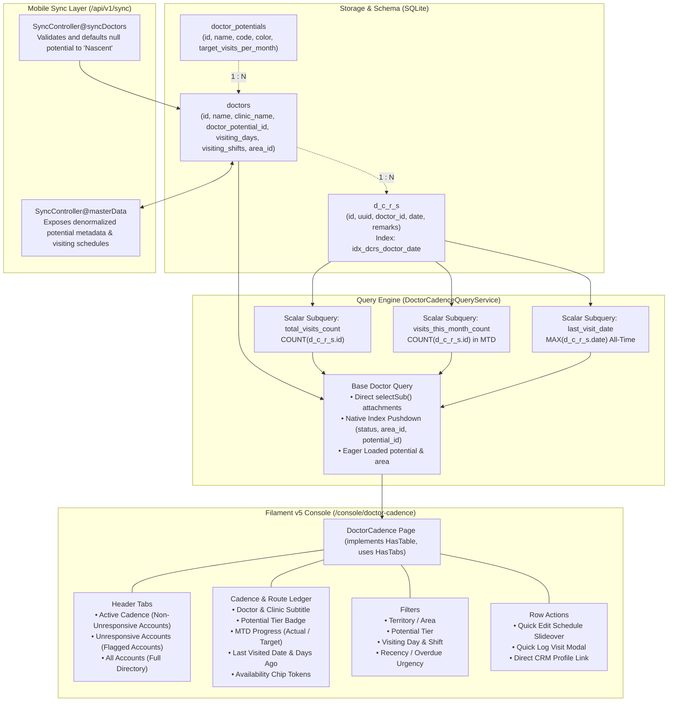

# Doctor Call Cadence & Route Planning System

* **Author:** Exponit Labs Core Architecture
* **Status:** Approved (Ready for Implementation)
* **Date:** 2026-11-02
* **Target Module:** Admin Console CMS ([`DoctorCadence.php`](file:///Users/arm/Herd/exponitlabs/app/Filament/Pages/DoctorCadence.php) at `/console/doctor-cadence`)

---

## Overview

The Doctor Call Cadence & Route Planning System is an operational territory management interface embedded within the Exponit Labs Filament v5 administrative console (`/console/doctor-cadence`). It provides sales leadership, regional operations managers, and field Medical Representatives (MRs) with structured visibility into physician visit recency, monthly call frequency adherence, clinic availability timings, and commercial potential tiers across all 233 registered healthcare providers.

By integrating database-backed commercial potential tiers (`Core`, `Serious`, `Nascent`, `Unresponsive`) with structured visiting schedules (`visiting_days` and `visiting_shifts`) and real-time Daily Call Report (DCR) historical logging, the system replaces ad-hoc daily visit planning with systematic, overdue-prioritized route management.

---

## Problem Statement

Field medical representatives currently plan daily clinic visits without systematic scheduling discipline. Field representatives frequently schedule visits ad hoc based on proximity or personal preference rather than territory priority or target call frequencies.

This creates operational deficiencies:
1. **Neglected Key Accounts**: High-potential physicians ("Core" prescribers who warrant weekly detailing) are frequently neglected for 30–60+ days without management detection, leading to relationship decay and lost prescription volume.
2. **Over-Detailing of Stagnant Accounts**: Reps repeatedly call on convenient, nearby doctors who fail to generate reciprocal commercial returns, wasting limited field travel time and sample expenditure.
3. **Availability Disconnect**: Doctors practice on specific days (e.g., Wednesdays and Thursdays only) or specific shifts (Morning hospital Outpatient Department [OPD] vs. Evening private clinic). Without centralized availability records, reps arrive at clinics when doctors are unavailable, generating wasted travel time and missed calls.
4. **Unclassified Relationship Inventory**: 140 of the 233 doctors (60%) currently have zero visit records in the database, with no mechanism to separate newly registered prospect accounts from dormant, unresponsive clinics.

---

## Goals

1. **Database-Backed Account Potential Tiers**: Introduce a dynamic `doctor_potentials` table defining account priority (`Core`, `Serious`, `Nascent`, `Unresponsive`) and establishing monthly target visit frequencies (`4`, `2`, `1`, and `0` visits/month) without hardcoded PHP enum constraints.
2. **Standardized Doctor Availability Profiling**: Capture doctor availability on `doctors` via multi-select visiting days (`Monday`–`Sunday`) and practicing shifts (`Morning`, `Afternoon`, `Evening`), with an open-door convention where blank/unrestricted schedules represent full availability (`Daily (All Shifts)`).
3. **Operational Cadence & Route Ledger**: Provide a dedicated Filament v5 management page at `/console/doctor-cadence` displaying:
   - Doctor identity, clinic name, territory area, and potential tier badge.
   - All-time total visits and Month-to-Date (MTD) visits vs. target ratio (e.g. `2 / 4 calls`).
   - All-time last visit date and relative days elapsed (`days_since_last_visit`).
   - Compact availability tokens (e.g. `M · W · F (Morn)` or `Daily (All Shifts)`).
4. **Multi-Criteria Route Filtering**: Enable managers to filter the doctor ledger by:
   - Territory / Area (geographic route beat clustering).
   - Visiting Day of Week (e.g., "Show all doctors available on Wednesday").
   - Practicing Shift (e.g., "Morning" vs "Evening").
   - Potential Tier (defaulting to active prescribers while isolating `Unresponsive` accounts).
   - Recency & Overdue Status (e.g., Overdue >30d, >60d, Never Visited).
5. **Database-Level Query Optimization**: Compute all visit counts and last visit dates directly in database queries using correlated scalar subqueries, avoiding $O(N)$ PHP memory loops and enabling native database column sorting.
6. **Offline Sync Compatibility**: Ensure offline doctor creation on the mobile field web application (`/elos`) assigns the `Nascent` tier as an operational baseline, maintaining consistent cadence targets across all newly registered prescribers.

---

## Non-Goals

1. **Automated GPS Routing & Turn-by-Turn Navigation (v1)**: The system does not calculate traveling-salesman multi-stop driving routes or integrate real-time Google Maps directions. Routing is facilitated by tabular filtering on Area, Days, and Shifts.
2. **Hard Detailing Visit Blocking**: Visiting an off-schedule or "Unresponsive" doctor will NOT be blocked on the mobile field web app (`/elos`). Impromptu calls, emergency visits, and rescheduled meetings remain loggable.
3. **Automated Commercial Tier Promotion / Demotion**: Potential tiers are assigned and adjusted manually by sales management in v1. Automatic algorithm-based tier upgrades based on secondary sales revenue are postponed to v2.
4. **Desktop-Only Field App Replacement**: This feature implements the administrative reporting and planning console at `/console/doctor-cadence`. Field synchronization of schedule attributes to Dexie.js IndexedDB on `/elos` will be supported via master data payload, but the mobile PWA view remains dedicated to call logging.

---

## Critical User Journeys (CUJs)

### CUJ 1: Territory Manager Plans Wednesday Morning Route
* **Given**: A territory sales manager is planning the field route for Wednesday morning in the "South Mumbai" territory.
* **When**: The manager navigates to `/console/doctor-cadence`, selects Area: "South Mumbai", Visiting Day: "Wednesday", and Shift: "Morning".
* **Then**: The ledger filters to doctors who either explicitly practice on Wednesday Morning or have open availability (`Daily`), sorted by longest overdue (`last_visit_date ASC NULLS FIRST`), allowing the manager to dispatch the rep to the highest-priority neglected doctors first.

### CUJ 2: Sales Director Audits Monthly Cadence Compliance
* **Given**: A sales director is reviewing territory coverage at mid-month.
* **When**: The director opens `/console/doctor-cadence` and filters by Potential: "Core".
* **Then**: The table displays all Tier 1 accounts with their monthly progress (e.g. `1 / 4 calls`), highlighting Core prescribers who have received 0 calls this month and are overdue for detailing.

### CUJ 3: Representative Tags Unresponsive Account
* **Given**: An MR has visited Dr. Kapoor three times over two months with zero response, sample uptake, or prescription generation.
* **When**: The manager opens Dr. Kapoor's profile and updates the potential tier from "Nascent" to "Unresponsive".
* **Then**: Dr. Kapoor is automatically excluded from the default active route planning views so reps can focus on yielding prescribers, while historical DCRs remain preserved and accessible in the "Unresponsive Accounts" tab.

---

## Proposed Architecture

### 1. Architectural System Overview

The system bridges doctor master records (`doctors`), historical daily call logs (`d_c_r_s`), and a dynamic potential tier subsystem (`doctor_potentials`). All cadence metrics are resolved at the database level via a dedicated query service (`DoctorCadenceQueryService`) that attaches scalar subqueries directly to the base `Doctor::query()`, avoiding in-memory derived table materialization in SQLite and allowing table filters to leverage the composite index.



---

### 2. Database Schema & Migration Specifications

#### A. `doctor_potentials` Table Migration
```php
Schema::create('doctor_potentials', function (Blueprint $table) {
    $table->id();
    $table->string('name', 64);                                // "Core", "Serious", "Nascent", "Unresponsive"
    $table->string('code', 32)->unique();                       // "core", "serious", "nascent", "unresponsive"
    $table->string('color', 32)->default('gray');               // Filament color token ('success', 'info', 'warning', 'gray')
    $table->unsignedSmallInteger('sort_order')->default(0)->index();
    $table->unsignedSmallInteger('target_visits_per_month')->default(1);
    $table->boolean('is_active')->default(true)->index();
    $table->timestamps();
});
```

**Standard Tier Configuration**:
| Name | Code | Color | Sort Order | Target Visits / Month | Target Cadence | Description |
| :--- | :--- | :--- | :--- | :--- | :--- | :--- |
| **Core** | `core` | `success` | 1 | 4 calls/mo | Weekly (every 7 days) | High-volume prescribers warranting weekly detailing |
| **Serious** | `serious` | `info` | 2 | 2 calls/mo | Bi-weekly (every 15 days) | Regular prescribers warranting bi-weekly contact |
| **Nascent** | `nascent` | `warning` | 3 | 1 call/mo | Monthly (every 30 days) | Default tier for new/developing prescribers |
| **Unresponsive** | `unresponsive` | `gray` | 4 | 0 calls/mo | Shelved / Dormant | Accounts showing no commercial return |

#### B. `doctors` Table Modifications
```php
Schema::table('doctors', function (Blueprint $table) {
    $table->foreignId('doctor_potential_id')
        ->nullable()
        ->after('area_id')
        ->constrained('doctor_potentials')
        ->nullOnDelete();

    $table->json('visiting_days')->nullable()->after('clinic_name');
    $table->json('visiting_shifts')->nullable()->after('visiting_days');

    // Composite index for filtered cadence queries
    $table->index(['status', 'doctor_potential_id', 'area_id'], 'idx_doctors_cadence_lookup');
    $table->index('doctor_potential_id');
});
```

**Legacy Data Baseline**:
The initial migration updates all existing doctors where `doctor_potential_id IS NULL` to the **'Nascent'** tier ID, ensuring that all 233 registered physicians have a baseline visit frequency target upon migration.

---

### 3. Database Query Architecture

To ensure low-latency query execution and avoid $O(N)$ memory overhead across large datasets, `App\Services\DoctorCadenceQueryService` builds directly on the base `Doctor::query()`, attaching scalar subqueries:

#### A. Correlated Scalar Subqueries
1. **`total_visits_count`**:
   ```php
   $totalVisitsQuery = DCR::query()
       ->selectRaw('COUNT(*)')
       ->whereColumn('d_c_r_s.doctor_id', 'doctors.id');
   ```
2. **`visits_this_month_count`**:
   ```php
   $visitsThisMonthQuery = DCR::query()
       ->selectRaw('COUNT(*)')
       ->whereColumn('d_c_r_s.doctor_id', 'doctors.id')
       ->where('d_c_r_s.date', '>=', now()->startOfMonth()->toDateString())
       ->where('d_c_r_s.date', '<=', now()->endOfMonth()->toDateString());
   ```
3. **`last_visit_date`** (All-Time, Immutable):
   ```php
   $lastVisitDateQuery = DCR::query()
       ->selectRaw('MAX(d_c_r_s.date)')
       ->whereColumn('d_c_r_s.doctor_id', 'doctors.id');
   ```
   *(Design Requirement: `last_visit_date` is not filtered by the current month, preventing accounts unvisited this month from falsely showing as "Never Visited".)*

#### B. Query Assembly & Native Sorting
Attaching subqueries via `selectSub()` preserves the physical table context in SQLite:
```php
$query = Doctor::query()
    ->where('doctors.status', 'active')
    ->select('doctors.*')
    ->selectSub($totalVisitsQuery, 'total_visits_count')
    ->selectSub($visitsThisMonthQuery, 'visits_this_month_count')
    ->selectSub($lastVisitDateQuery, 'last_visit_date')
    ->with(['potential', 'area.headquarter']);
```

1. **Native Overdue Sorting**: Overdue sorting is executed directly on `last_visit_date ASC NULLS FIRST` (or `last_visit_date DESC NULLS LAST`), eliminating SQLite Julian day arithmetic overhead.
2. **Relative Date Rendering**: Relative time subtitles (e.g. `14 days ago` or `Never Visited`) are calculated in the Filament table formatter via Carbon's `diffForHumans()`, which executes in <0.1ms for paginated datasets.
3. **Target Ratio Evaluation**: Progress ratios (`actual / target`) are rendered in PHP using the eager-loaded `potential` relation. If target is 0 (`Unresponsive`), the table renders `—` to prevent division-by-zero errors.

---

### 4. Filament Administrative Console Interface (`/console/doctor-cadence`)

#### A. Navigation & Page Registration
- **Class**: `App\Filament\Pages\DoctorCadence`
- **Panel**: `console`
- **Route**: `/console/doctor-cadence`
- **Group**: `Field Operations`
- **Label**: `Cadence & Route Planning`
- **Icon**: `Heroicon::OutlinedCalendarDays`
- **View**: `filament.pages.doctor-cadence` (rendering `{{ $this->content }}`)
- **Contracts**: Implements `Filament\Tables\Contracts\HasTable`, uses `Filament\Resources\Concerns\HasTabs` and `Filament\Tables\Concerns\InteractsWithTable`.

#### B. Header Tabs (`HasTabs`)
Tabs are partitioned strictly by commercial potential tier:
1. **Active Cadence** (Default): Prescribers in active commercial tiers (`Core`, `Serious`, `Nascent`, including doctors with null tier). Overdue accounts sort to the top when ordered by `last_visit_date ASC`.
   ```php
   Tab::make('Active Cadence')
       ->badge(fn () => Doctor::whereHas('potential', fn ($q) => $q->where('code', '!=', 'unresponsive'))->orWhereNull('doctor_potential_id')->count())
       ->modifyQueryUsing(fn (Builder $query) => $query->where(function (Builder $q) {
           $q->whereHas('potential', fn ($p) => $p->where('code', '!=', 'unresponsive'))
             ->orWhereNull('doctor_potential_id');
       }));
   ```
2. **Unresponsive Accounts**: Accounts explicitly flagged with the `Unresponsive` tier.
   ```php
   Tab::make('Unresponsive Accounts')
       ->badge(fn () => Doctor::whereHas('potential', fn ($q) => $q->where('code', 'unresponsive'))->count())
       ->modifyQueryUsing(fn (Builder $query) => $query->whereHas('potential', fn ($q) => $q->where('code', 'unresponsive')));
   ```
3. **All Accounts**: Unfiltered directory of all 233 doctors.

#### C. Table Layout & Typographic Zones
* **Zone 1: Identity & Classification**:
  - `name`: Doctor Name (FontWeight: SemiBold) with clinic name and area subtitle.
  - `potential.name`: Badge column with dynamic color token from `doctor_potentials.color`.
* **Zone 2: Cadence Progress & Recency**:
  - `visits_this_month`: Formatted as `actual / target calls` (e.g. `1 / 4 calls`). If target is 0, renders `—`. Colored warning if deficient mid-month, success if target met.
  - `total_visits_count`: Integer lifetime detailing count.
  - `last_visit_date`: Date formatted (`d M Y`), with relative time subtitle (e.g. `14 days ago`). If null, renders `Never Visited` in danger badge. Sortable natively on `last_visit_date`.
* **Zone 3: Route Scheduling & Actions**:
  - `availability`: Compact single-line token. If null or empty schedule, displays emerald badge: `Daily (All Shifts)`. If restricted, renders formatted tokens (e.g. `Mon · Wed · Fri (Morn)`) with tooltip.
  - `actions`: Action Group (`editSchedule`, `logVisit`, `viewDoctor`).

#### D. Dynamic Filters
1. **Area / Territory**: `SelectFilter::make('area_id')->relationship('area', 'name')->searchable()->preload()`.
2. **Potential Tier**: `SelectFilter::make('doctor_potential_id')->relationship('potential', 'name')`.
3. **Visiting Day**: `SelectFilter::make('visiting_day')` querying via SQLite's `json_each()` with empty-schedule fallback:
   ```php
   $query->where(function (Builder $q) use ($day) {
       $q->whereJsonContains('visiting_days', $day)
         ->orWhereNull('visiting_days')
         ->orWhere('visiting_days', '[]')
         ->orWhere('visiting_days', '');
   });
   ```
4. **Visiting Shift**: `SelectFilter::make('visiting_shift')` querying `morning`, `afternoon`, `evening` with open-availability fallback (`orWhereNull`, `orWhere('visiting_shifts', '[]')`).
5. **Cadence Urgency**: `Filter` with options:
   - `Never Visited`: `whereNull('last_visit_date')`.
   - `Overdue (>30d)`: `where('last_visit_date', '<', now()->subDays(30)->toDateString())`.
   - `Severely Overdue (>60d)`: `where('last_visit_date', '<', now()->subDays(60)->toDateString())`.

#### E. Slideover & Modal Actions
1. **Quick Edit Schedule (`editSchedule`)**:
   Slideover modal utilizing shared form components from `DoctorForm::getScheduleComponents()`:
   - `Select::make('doctor_potential_id')->relationship('potential', 'name')->required()`
   - `CheckboxList::make('visiting_days')->options([...])->columns(4)->bulkToggleable()`
   - `CheckboxList::make('visiting_shifts')->options([...])->columns(3)->bulkToggleable()`
2. **Log DCR Visit (`logVisit`)**:
   Modal action to immediately record an executed call:
   - `DatePicker::make('date')->default(today())->maxDate(today())->required()`
   - `TextInput::make('remarks')->placeholder('Detailing notes & product feedback')`
   - Submitting inserts into `d_c_r_s`, generating a UUID and updating `last_visit_date`.

---

### 5. Offline Sync & Backward Compatibility

#### A. Sync Payload Serialization (`SyncController@masterData`)
Extend doctor serialization to include denormalized tier metadata and visiting schedules:
```php
'potential' => [
    'id' => $doc->potential?->id,
    'code' => $doc->potential?->code ?? 'nascent',
    'name' => $doc->potential?->name ?? 'Nascent',
    'color' => $doc->potential?->color ?? 'warning',
    'target_visits_per_month' => $doc->potential?->target_visits_per_month ?? 1,
],
'visiting_days' => $doc->visiting_days,
'visiting_shifts' => $doc->visiting_shifts,
```

#### B. Offline Creation Guardrails (`SyncController@syncDoctors`)
Extend validation and mapping to safely persist offline doctor entries:
```php
$validated = $request->validate([
    // ... existing rules ...
    'doctors.*.doctor_potential_id' => 'nullable|integer|exists:doctor_potentials,id',
    'doctors.*.visiting_days' => 'nullable|array',
    'doctors.*.visiting_shifts' => 'nullable|array',
]);

$nascentId = DoctorPotential::where('code', 'nascent')->value('id');

Doctor::updateOrCreate(
    ['uuid' => $item['uuid']],
    [
        // ... existing fields ...
        'doctor_potential_id' => $item['doctor_potential_id'] ?? $nascentId,
        'visiting_days' => !empty($item['visiting_days']) ? $item['visiting_days'] : null,
        'visiting_shifts' => !empty($item['visiting_shifts']) ? $item['visiting_shifts'] : null,
    ]
);
```

---

## Risks & Mitigations

### 1. SQLite Write Contention & Locking During Field Sync
* **Risk**: Simultaneous DCR logging from the admin console and mobile batch uploads from `/elos` can trigger `database is locked` exceptions in SQLite.
* **Mitigation**:
  - Exponit Labs runs in SQLite WAL (Write-Ahead Logging) mode with `busy_timeout = 5000ms`, enabling concurrent readers while serializing writers.
  - Wrap batch synchronization in short, single-transaction blocks in `SyncController`.

### 2. Timezone & Date Boundary Drift
* **Risk**: Evaluating relative days and month boundaries using server system time (`julianday('now', 'localtime')`) can drift on UTC servers, causing mid-month call deficit miscalculations.
* **Mitigation**:
  - Bind explicit application dates in local IST (`Carbon::today()->toDateString()`, `Carbon::now()->startOfMonth()->toDateString()`).
  - Constrain `logVisit` date picker to `->maxDate(today())` to prevent future visits producing negative elapsed days.

### 3. Query Latency on Scaling DCR Volumes
* **Risk**: Correlated scalar subqueries on `d_c_r_s` could degrade as total visit history grows beyond 100,000 rows.
* **Mitigation**:
  - The database already maintains the composite index `idx_dcrs_doctor_date` on `(doctor_id, date)`.
  - Attaching subqueries via `selectSub()` allows Laravel to strip them automatically during pagination `COUNT(*)` queries, ensuring that pagination count queries remain sub-millisecond table scans on `doctors`.

### 4. Empty JSON Array Dehydration
* **Risk**: Livewire form submission dehydrates unselected checkboxes into `'[]'` strings, breaking SQL `orWhereNull()` checks for open availability.
* **Mitigation**:
  - Apply `dehydrateStateUsing(fn ($state) => empty($state) ? null : array_values($state))` to both form fields.
  - Include defensive `orWhere('visiting_days', '[]')` clauses in Eloquent model scopes.

---

## Alternatives Considered

### Alternative 1: PHP 8.4 Backed Enum for Commercial Potential Tiers
* **Description**: Implement potential tiers as a native PHP backed enum (`App\Enums\DoctorPotentialTier: string`) and store a string column on `doctors`.
* **Pros**:
  - No separate lookup migration or seeder needed.
  - Compile-time type safety throughout PHP code.
* **Why Rejected**:
  - The user explicitly requested database storage over hardcoded enums so potential tiers can be modified, reconfigured, or extended dynamically in the database without requiring code deployments.
  - A database table cleanly isolates commercial metadata (monthly visit target `target_visits_per_month`, UI color token `color`, and `sort_order`), eliminating hardcoded PHP `match` statements across the codebase.

### Alternative 2: Many-to-Many Relational Tagging Architecture (Pivot Table)
* **Description**: Model potential tiers via a many-to-many relationship (`doctor_potential_doctor` or audit log pivot) to record tier transition history.
* **Pros**:
  - Preserves a complete audit trail of when doctors were promoted or demoted between tiers.
* **Why Rejected**:
  - Excessive architectural overhead for current requirements. A doctor has exactly one commercial priority tier at any given time.
  - Joins across pivot tables add unnecessary query complexity to every list view and offline sync payload, degrading query performance without operational need for v1.

### Alternative 3: Granular Day-Shift Slot Matrix (`slot` JSON or Normalized Table)
* **Description**: Model availability as explicit paired tuples, such as `[{"day": "monday", "shift": "morning"}, {"day": "friday", "shift": "evening"}]`, or a dedicated child table.
* **Pros**:
  - Enables specifying that a doctor is available Monday morning, but only Friday evening.
* **Why Rejected**:
  - In Indian pharmaceutical field detailing, clinic timings are predominantly consistent (e.g., "Available Mon/Wed/Fri in the morning OPD"). A paired matrix introduces severe UI friction on both mobile and admin forms, requiring a 21-checkbox grid (7 days × 3 shifts).
  - Storing multi-select days (`visiting_days`) alongside broad shifts (`visiting_shifts`) with an open-door convention (`NULL = Daily All Shifts`) covers >95% of real-world field scheduling requirements while maintaining a two-field form input structure.

### Alternative 4: In-Memory Filament Table Accessors & PHP Closures
* **Description**: Retrieve standard `Doctor` Eloquent models and compute `total_visits`, `last_visit_date`, and `days_since_last_visit` using PHP model accessors or Livewire closures.
* **Pros**:
  - Simpler initial query structure without nested subqueries.
* **Why Rejected**:
  - Eager loading or lazy loading DCRs in PHP triggers severe $O(N)$ memory and query overhead across 233 doctors.
  - Breaks native database pagination, search, and sorting. Reps and managers could not sort by `days_since_last_visit` or filter by overdue thresholds at the SQLite engine level.
  - Attaching indexed scalar subqueries ensures low-latency execution and native SQLite engine column sorting.

---

## Detailed Implementation Plan

The implementation is structured into 7 sequential phases to ensure database migration validity, backward compatibility across existing modules, and automated test coverage.

### Phase 1: Database Schema & Domain Models

#### 1. `database/migrations/YYYY_MM_DD_000001_create_doctor_potentials_table.php` [Create]
- **Rationale**: Establish a dedicated lookup table for commercial account potential tiers.
- **Key Columns**:
  - `id`: Primary key.
  - `name`: Human-readable label (`Core`, `Serious`, `Nascent`, `Unresponsive`).
  - `code`: Unique lowercase machine code (`core`, `serious`, `nascent`, `unresponsive`).
  - `target_visits_per_month`: Unsigned tiny integer target frequency (`4`, `2`, `1`, `0`). Default `1`.
  - `color`: Filament color identifier string (`success`, `info`, `warning`, `gray`). Default `gray`.
  - `sort_order`: Unsigned tiny integer for UI ordering (`1`, `2`, `3`, `4`). Default `0`.
  - `is_active`: Boolean default `true`. Indexed.
  - `timestamps()`.

#### 2. `database/migrations/YYYY_MM_DD_000002_add_potential_and_schedule_to_doctors_table.php` [Create]
- **Rationale**: Equip doctor records with commercial tier classification, clinic practicing days, and practicing shifts.
- **Key Alterations**:
  - `doctor_potential_id`: Nullable foreign ID referencing `doctor_potentials(id)` with `nullOnDelete()`.
  - `visiting_days`: Nullable `json` array storing active weekdays (e.g. `["monday", "wednesday", "friday"]`). Positioned `->after('clinic_name')`.
  - `visiting_shifts`: Nullable `json` array storing broad time slots (e.g. `["morning", "evening"]`). Positioned `->after('visiting_days')`.
  - Index: Add composite index `idx_doctors_cadence_lookup` on `['status', 'doctor_potential_id', 'area_id']`.

#### 3. `app/Models/DoctorPotential.php` [Create]
- **Rationale**: Eloquent representation of commercial potential lookup.
- **Specifications**:
  - `$fillable = ['name', 'code', 'target_visits_per_month', 'color', 'sort_order', 'is_active']`.
  - `$casts = ['target_visits_per_month' => 'integer', 'sort_order' => 'integer', 'is_active' => 'boolean']`.
  - `doctors(): HasMany`: Defines relationship to `Doctor::class`.

#### 4. `app/Models/Doctor.php` [Modify]
- **Rationale**: Bind foreign relationship, JSON casts, and availability query scopes.
- **Modifications**:
  - Add to `$fillable`: `'doctor_potential_id'`, `'visiting_days'`, `'visiting_shifts'`.
  - Add to `$casts`: `'visiting_days' => 'array'`, `'visiting_shifts' => 'array'`.
  - Relation `potential(): BelongsTo`: Return `belongsTo(DoctorPotential::class, 'doctor_potential_id')`.
  - Scope `scopeAvailableOnDay(Builder $query, string $day)`:
    ```php
    return $query->where(function (Builder $q) use ($day) {
        $q->whereJsonContains('visiting_days', $day)
          ->orWhereNull('visiting_days')
          ->orWhere('visiting_days', '[]')
          ->orWhere('visiting_days', '');
    });
    ```
  - Scope `scopeAvailableOnShift(Builder $query, string $shift)`: Match shifts with open availability fallback.
  - Model Event `booted()`: Ensure `doctor_potential_id` defaults to the `Nascent` tier ID if saved without a tier.

#### 5. `app/Models/DCR.php` [Modify]
- **Rationale**: Guarantee UUID generation across all creation vectors.
- **Modifications**:
  - In `booted()`:
    ```php
    static::creating(function (DCR $dcr) {
        $dcr->uuid = $dcr->uuid ?? (string) Str::uuid();
    });
    ```

---

### Phase 2: Factories & Master Seeders

#### 6. `database/factories/DoctorPotentialFactory.php` [Create]
- **Rationale**: Provide factory definition for isolated Pest testing.
- **Definition**:
  ```php
  return [
      'name' => 'Nascent',
      'code' => 'nascent',
      'target_visits_per_month' => 1,
      'color' => 'warning',
      'sort_order' => 3,
      'is_active' => true,
  ];
  ```

#### 7. `database/seeders/DoctorPotentialSeeder.php` [Create]
- **Rationale**: Seed standard commercial tiers and link all 233 existing doctors to the default `Nascent` tier.
- **Execution Logic**:
  - `DoctorPotential::firstOrCreate(['code' => 'core'], ['name' => 'Core', 'target_visits_per_month' => 4, 'color' => 'success', 'sort_order' => 1])`.
  - `DoctorPotential::firstOrCreate(['code' => 'serious'], ['name' => 'Serious', 'target_visits_per_month' => 2, 'color' => 'info', 'sort_order' => 2])`.
  - `DoctorPotential::firstOrCreate(['code' => 'nascent'], ['name' => 'Nascent', 'target_visits_per_month' => 1, 'color' => 'warning', 'sort_order' => 3])`.
  - `DoctorPotential::firstOrCreate(['code' => 'unresponsive'], ['name' => 'Unresponsive', 'target_visits_per_month' => 0, 'color' => 'gray', 'sort_order' => 4])`.
  - Batch update: `Doctor::whereNull('doctor_potential_id')->update(['doctor_potential_id' => $nascentId])`.

#### 8. `database/seeders/DatabaseSeeder.php` [Modify]
- **Rationale**: Register `DoctorPotentialSeeder` in main database seeder execution chain.
- **Addition**: Add `$this->call(DoctorPotentialSeeder::class);` to `run()`.

---

### Phase 3: Cadence Query Service

#### 9. `app/Services/DoctorCadenceQueryService.php` [Create]
- **Rationale**: Correlated scalar query builder delegating column sorting to SQLite and avoiding in-memory loops.
- **Core Implementation**:
  ```php
  namespace App\Services;

  use App\Models\DCR;
  use App\Models\Doctor;
  use Illuminate\Database\Eloquent\Builder;

  class DoctorCadenceQueryService
  {
      public function getEloquentQuery(): Builder
      {
          $totalVisitsQuery = DCR::query()
              ->selectRaw('COUNT(*)')
              ->whereColumn('d_c_r_s.doctor_id', 'doctors.id');

          $visitsThisMonthQuery = DCR::query()
              ->selectRaw('COUNT(*)')
              ->whereColumn('d_c_r_s.doctor_id', 'doctors.id')
              ->where('d_c_r_s.date', '>=', now()->startOfMonth()->toDateString())
              ->where('d_c_r_s.date', '<=', now()->endOfMonth()->toDateString());

          $lastVisitDateQuery = DCR::query()
              ->selectRaw('MAX(d_c_r_s.date)')
              ->whereColumn('d_c_r_s.doctor_id', 'doctors.id');

          return Doctor::query()
              ->where('doctors.status', 'active')
              ->select('doctors.*')
              ->selectSub($totalVisitsQuery, 'total_visits_count')
              ->selectSub($visitsThisMonthQuery, 'visits_this_month_count')
              ->selectSub($lastVisitDateQuery, 'last_visit_date')
              ->with(['potential', 'area.headquarter']);
      }
  }
  ```

---

### Phase 4: Doctor Master Form & Table Upgrades

#### 10. `app/Filament/Resources/Doctors/Schemas/DoctorForm.php` [Modify]
- **Rationale**: Provide reusable schedule form components and allow editing potential tiers and availability.
- **Additions**:
  - `public static function getScheduleComponents(): array`:
    - `Select::make('doctor_potential_id')->relationship('potential', 'name')->default(fn () => DoctorPotential::where('code', 'nascent')->value('id'))->required()`.
    - `CheckboxList::make('visiting_days')->options(['monday' => 'Monday', 'tuesday' => 'Tuesday', 'wednesday' => 'Wednesday', 'thursday' => 'Thursday', 'friday' => 'Friday', 'saturday' => 'Saturday', 'sunday' => 'Sunday'])->dehydrateStateUsing(fn ($state) => empty($state) ? null : array_values($state))->columns(4)->bulkToggleable()->helperText('Leave empty if doctor meets every day.')`.
    - `CheckboxList::make('visiting_shifts')->options(['morning' => 'Morning (OPD)', 'afternoon' => 'Afternoon', 'evening' => 'Evening (Private Clinic)'])->dehydrateStateUsing(fn ($state) => empty($state) ? null : array_values($state))->columns(3)->bulkToggleable()->helperText('Leave empty if available during all shifts.')`.
  - Incorporate `Section::make('Commercial Priority & Visiting Schedule')->schema(static::getScheduleComponents())` into `DoctorForm::configure()`.

#### 11. `app/Filament/Resources/Doctors/Tables/DoctorsTable.php` [Modify]
- **Rationale**: Surface potential tier badge in the primary Doctor Master directory with eager loading.
- **Additions**:
  - Add `modifyQueryUsing(fn ($query) => $query->with('potential'))`.
  - Add `TextColumn::make('potential.name')->label('Potential')->badge()->color(fn ($record) => $record->potential?->color ?? 'gray')->sortable()`.

---

### Phase 5: Cadence & Route Planning Management Console

#### 12. `app/Filament/Pages/DoctorCadence.php` [Create]
- **Rationale**: Central administrative screen for daily route planning, cadence tracking, and tier management.
- **Specifications**:
  - Signature: `class DoctorCadence extends Page implements HasTable`
  - Traits: `use HasTabs; use InteractsWithTable;`
  - Navigation: Group `'Field Operations'`, Icon `Heroicon::OutlinedCalendarDays`, Title `'Cadence & Route Planning'`, Slug `'doctor-cadence'`.
  - Schema:
    ```php
    public function content(Schema $schema): Schema
    {
        return $schema->components([
            $this->getTabsContentComponent(),
            EmbeddedTable::make(),
        ]);
    }
    ```
  - Tabs (`getTabs()`):
    - `active`: Accounts with `code != 'unresponsive'` (or `doctor_potential_id IS NULL`).
    - `unresponsive`: Accounts flagged `code = 'unresponsive'`.
    - `all`: All 233 doctors.
  - Columns:
    - `name`: Doctor Name (SemiBold) with clinic name and area subtitle.
    - `potential.name`: Badge column colored via tier metadata.
    - `visits_this_month`: Formatted as `actual / target calls`. Displays `—` if target is 0.
    - `total_visits_count`: Integer lifetime calls.
    - `last_visit_date`: Date formatted (`d M Y`) with relative time subtitle. Renders `Never Visited` danger badge if null. Sortable natively on `last_visit_date`.
    - `availability`: Compact badge. `Daily (All Shifts)` if null; formatted tokens (e.g. `Mon · Wed · Fri (Morn)`) if restricted.
  - Actions:
    - `editSchedule`: Slideover modal using `DoctorForm::getScheduleComponents()`.
    - `logVisit`: Modal action inserting an executed call into `d_c_r_s` with idempotency check.
  - Filters:
    - `area_id`: SelectFilter for territory clustering.
    - `doctor_potential_id`: SelectFilter for commercial tiers.
    - `visiting_day`: Day-of-week filter with `whereJsonContains` + empty schedule fallback.
    - `visiting_shift`: Shift filter (`morning`, `afternoon`, `evening`) with empty schedule fallback.
    - `cadence_urgency`: Filter for `Never Visited`, `Overdue (>30d)`, `Severely Overdue (>60d)`.

#### 13. `resources/views/filament/pages/doctor-cadence.blade.php` [Create]
- **Rationale**: Blade template container rendering the Livewire page schema.
- **Content**:
  ```blade
  <x-filament-panels::page>
      {{ $this->content }}
  </x-filament-panels::page>
  ```

---

### Phase 6: API Synchronization & Mobile Compatibility

#### 14. `app/Http/Controllers/Api/SyncController.php` [Modify]
- **Rationale**: Maintain bidirectional data synchronization between the central server and offline MR mobile devices (`/elos`).
- **Modifications**:
  - In `masterData()`: Denormalize tier metadata onto the doctor payload:
    ```php
    'potential' => [
        'id' => $doc->potential?->id,
        'code' => $doc->potential?->code ?? 'nascent',
        'name' => $doc->potential?->name ?? 'Nascent',
        'color' => $doc->potential?->color ?? 'warning',
        'target_visits_per_month' => $doc->potential?->target_visits_per_month ?? 1,
    ],
    'visiting_days' => $doc->visiting_days,
    'visiting_shifts' => $doc->visiting_shifts,
    ```
  - In `syncDoctors()`:
    1. Add validation rules:
       ```php
       'doctors.*.doctor_potential_id' => 'nullable|integer|exists:doctor_potentials,id',
       'doctors.*.visiting_days' => 'nullable|array',
       'doctors.*.visiting_shifts' => 'nullable|array',
       ```
    2. Map attributes into `Doctor::updateOrCreate()`:
       ```php
       $nascentId = DoctorPotential::where('code', 'nascent')->value('id');
       // ...
       'doctor_potential_id' => $item['doctor_potential_id'] ?? $nascentId,
       'visiting_days' => !empty($item['visiting_days']) ? $item['visiting_days'] : null,
       'visiting_shifts' => !empty($item['visiting_shifts']) ? $item['visiting_shifts'] : null,
       ```

---

### Phase 7: Automated Testing & Verification Suite

#### 15. `tests/Feature/DoctorCadenceTest.php` [Create]
- **Rationale**: Pest v4 feature test suite verifying cadence calculations, filtering, UI actions, and API synchronization.
- **Test Scenarios**:
  1. `it('computes correct cadence recency and visit counts across all-time and mtd horizons')`: Verifies that `last_visit_date` reflects true all-time max even when filtering MTD.
  2. `it('sorts never-visited doctors to the top when triaging overdue accounts')`: Verifies `last_visit_date ASC NULLS FIRST` behavior.
  3. `it('filters doctors by day and shift respecting the open-availability fallback')`: Asserts that an open-door doctor (`visiting_days = null` or `'[]'`) appears in Wednesday morning queries alongside explicitly scheduled doctors.
  4. `it('allows updating doctor potential and visiting schedule via slideover action')`: Verifies `editSchedule` action persists changes to the database.
  5. `it('logs a dcr call via table action and recalculates recency to 0 days')`: Verifies `logVisit` action creates DCR with UUID and updates table state.
  6. `it('synchronizes potential and schedule to mobile master data and defaults offline doctors to nascent')`: Verifies `SyncController` contracts.

#### 16. Verification & Linting Commands
Execute targeted test suite and enforce project code standards:
```bash
# Run targeted feature test suite
php artisan test --compact tests/Feature/DoctorCadenceTest.php

# Run full test suite
php artisan test --compact

# Enforce code style
vendor/bin/pint --dirty --format agent
```
