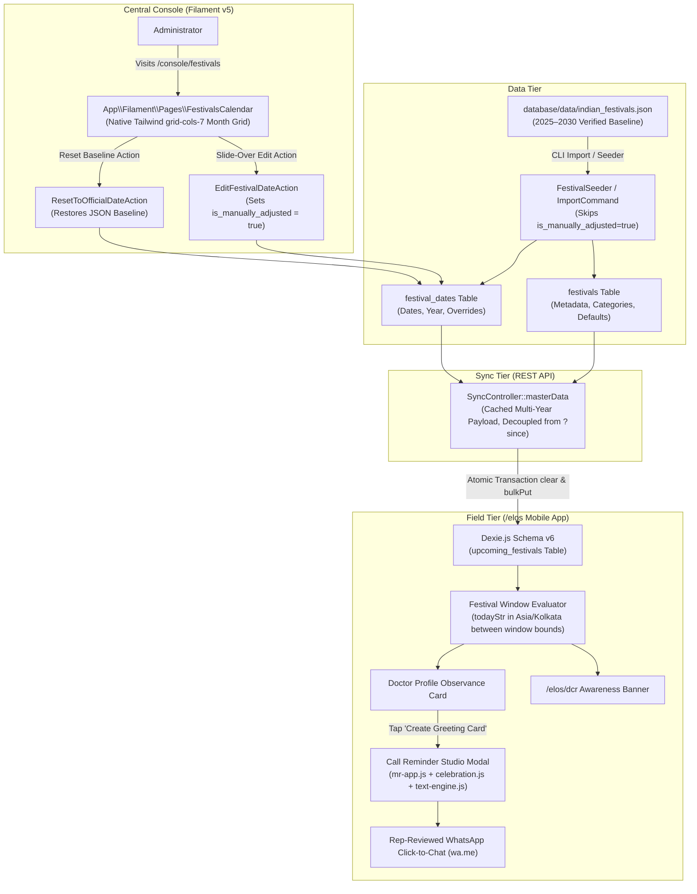
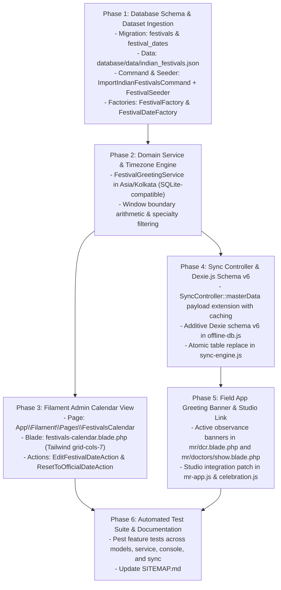

# Centralized Indian Festival & Healthcare Observance Calendar Engine

* **Author:** Exponit Labs Engineering Team
* **Status:** Implemented (Verified)
* **Date:** 2026-11-03

---

## Overview

The Centralized Indian Festival & Healthcare Observance Calendar Engine provides a database-backed calendar system to manage major Indian cultural festivals, national holidays, and healthcare observances across 2025–2030.

Rather than recording sensitive personal doctor attributes (such as religion or community), the system approaches relationship-building through an objective, calendar-driven greeting engine. Administrators maintain and adjust festival dates centrally within a month-by-month calendar grid in the Filament admin console (`/console/festivals`), allowing date adjustments for moon sightings (such as Eid-ul-Fitr and Eid-ul-Adha) and regional notifications.

In the offline-first field app used by Medical Representatives (`/elos`), active greeting windows highlight upcoming observances without requiring continuous network connectivity, connecting directly into the existing celebration card canvas and festive text generation engine.

---

## The Problem

Medical Representatives (MRs) rely on timely personal touchpoints—such as festival greetings and healthcare day recognitions—to build strong professional rapport with doctors. In the current workflow, representatives face four operational constraints:

1. **Absence of Centralized Calendar Awareness**: Representatives have no structured calendar awareness inside the field app, which leads to missed dates or unstandardized messaging.
2. **Privacy and Compliance Constraints of Religious Profiling**: Storing doctor religious affiliations or community tags creates data privacy liabilities under India's Digital Personal Data Protection (DPDP) Act. Relationship outreach must be calendar-driven and professional, not profile-driven.
3. **Lunisolar Date Shifts**: Key Indian observances follow lunisolar calendars (e.g., Eid-ul-Fitr, Eid-ul-Adha, Diwali, Holi) whose exact dates shift based on moon sightings and state gazette notifications. Static calendar data becomes inaccurate without administrative override controls.
4. **Clinical Specialty Relevance**: While national celebrations (such as Republic Day or National Doctor's Day on July 1) apply universally, clinical observances (such as World Heart Day or World Glaucoma Day) must be targeted. Sending clinical greeting cards to unrelated specialists is irrelevant to their practice.

---

## Goals

* **Pre-bundled Multi-Year Dataset**: Ingest a verified, static dataset of Indian national holidays, major cultural festivals, and healthcare observances for 2025–2030 derived from official Government of India (DoPT) Gazetted orders, IMD Rashtriya Panchang, and the Indian Medical Association (IMA).
* **Central Administrative Calendar (`/console/festivals`)**: Provide a responsive monthly grid in the Filament console allowing administrators to inspect all scheduled observances and update dates via slide-over actions.
* **Override Protection & Reset**: Protect manual date overrides (`is_manually_adjusted = true`) so that future deployments or automated database seeders never overwrite real-world adjustments, while providing a 1-click administrative action to restore the canonical gazetted baseline.
* **Deterministic Active Window Engine**: Define date window arithmetic in Indian Standard Time (`Asia/Kolkata`): an observance on date $D$ is active on target date $T$ when $(D - \text{days\_before}) \le T \le (D + \text{days\_after})$.
* **Offline Master Data Synchronization**: Deliver calendar updates to the `/elos` mobile field app via atomic table replacement in IndexedDB (Dexie schema v6) wrapped in an explicit transaction, avoiding sliding-window sync invalidation.
* **Direct Reuse of Existing Graphics & Text Assets**: Surface contextual festival banners in `/elos/dcr` and doctor profiles that open the existing Call Reminder Studio modal with the `celebration.js` canvas template pre-selected and festive greeting copy pre-populated.
* **Specialty Targeting for Clinical Days**: Allow clinical observances to restrict visibility to matching physician specialties, while keeping cultural and national holidays universal.

---

## Non-Goals

* **Doctor Demographic Profiling**: Excluded. No religion, community, or caste attributes are stored in the database or doctor records.
* **New Graphic Rendering Pipeline**: Deferred. The feature directly reuses the existing 1080x1080 canvas engine in `resources/js/reminder-cards/celebration.js` and copy templates in `resources/js/reminder-cards/text-engine.js`.
* **Video Generation**: Excluded from Phase 1.
* **Automated WhatsApp Broadcasting**: Messages are rep-initiated. Representatives trigger messages manually via click-to-chat links (`wa.me`) to comply with WhatsApp platform policies and maintain representative control over communications.
* **External Calendar JavaScript Libraries**: Do not embed third-party calendar packages (such as FullCalendar) in the Filament console.

---

## Open Questions

* **Regional State Gazette Variations**: Certain regional festivals (e.g., Onam in Kerala, Chhath Puja in Bihar/UP, Durga Puja in West Bengal) are celebrated primarily in specific states. The current specification treats all bundled festivals as nationally visible. Should an optional `state_id` filter be added in a future phase if state-level divisions expand?
  * *Status*: Documented for Phase 2 consideration. Multi-state accounts currently operate under unified national schedules.

---

## Critical User Journeys (CUJs)

### CUJ 1: Central Admin Modifies a Festival Date on Moon Sighting
* **Given**: An administrator is logged into the Filament console at `/console/festivals`. Eid-ul-Fitr is scheduled for March 31, 2025, but the moon sighting confirms the holiday is officially April 1, 2025.
* **When**: The administrator navigates to March 2025, clicks the Eid-ul-Fitr card badge, modifies the date to `2025-04-01`, and clicks Save.
* **Then**: The record in `festival_dates` updates to `2025-04-01`, sets `is_manually_adjusted = true`, and logs the admin user ID. Subsequent database seed runs preserve the adjusted date. If the shift was made in error, clicking "Reset to Official Date" restores `2025-03-31` and clears the manual flag.

### CUJ 2: Medical Representative Shares a Cultural Festival Greeting Offline
* **Given**: A Medical Representative is working offline in `/elos` on November 1, 2025. Diwali is on November 1, with `days_before = 3` and `days_after = 1`.
* **When**: The rep opens a doctor's profile (`/elos/doctors/{uuid}`) or visits the Daily Call Report (`/elos/dcr`).
* **Then**: On the DCR view, an awareness banner appears reminding the rep that the Diwali window is open. On the doctor profile, an inline card displays "Diwali Greeting Window Active". Tapping "Create Greeting Card" opens the Call Reminder Studio with the doctor loaded, the `celebration` canvas card template selected, and Diwali greeting text pre-filled. The rep generates the card and taps "Share on WhatsApp".

### CUJ 3: Specialty-Filtered Clinical Health Day Display
* **Given**: September 29 is World Heart Day, configured with `category = clinical_observance` and `target_specialties = ["Cardiology", "Internal Medicine"]`.
* **When**: An MR views a Cardiologist's profile in `/elos`.
* **Then**: The World Heart Day observance banner is visible. If the rep subsequently opens an Orthopedic Surgeon's profile or a doctor with `specialty = null`, the World Heart Day banner remains hidden.

---

## Technical Plan (Architecture)

### 1. High-Level System Architecture

The observance engine operates across three synchronized tiers: authoritative static data seeding, centralized administrative date management via Filament v5, and offline-first client evaluation in the `/elos` field app.



---

### 2. Database Schema & Data Models

The persistence layer separates festival taxonomy from yearly calendar instances.

#### Table: `festivals`
Stores the metadata, categorization, copy templates, and window duration defaults.

| Column | Type | Constraints / Modifiers | Description |
| :--- | :--- | :--- | :--- |
| `id` | `unsignedBigInteger` | `PK`, `auto_increment` | Primary key |
| `name` | `string` | `not null` | Display name (e.g., "Diwali", "Eid-ul-Fitr", "World Heart Day") |
| `slug` | `string` | `unique`, `not null` | Kebab-case URL identifier (e.g., `diwali`, `world-heart-day`) |
| `category` | `string` | `not null`, default: `'cultural_and_national'` | Either `'cultural_and_national'` or `'clinical_observance'` |
| `target_specialties` | `json` | `nullable` | Specialty tags for clinical filtering (e.g. `["Cardiology", "Internal Medicine"]`). Null for universal. |
| `days_before` | `unsignedTinyInteger` | `not null`, default: `3` | Number of days prior to the date when the greeting window opens |
| `days_after` | `unsignedTinyInteger` | `not null`, default: `1` | Number of days after the date when the greeting window closes |
| `greeting_message_template` | `text` | `nullable` | Pre-configured festive greeting copy template |
| `is_active` | `boolean` | `not null`, default: `true` | Soft toggle to deactivate an observance organization-wide |
| `timestamps` | `timestamp` | `nullable` | `created_at` and `updated_at` |

#### Table: `festival_dates`
Stores specific calendar occurrences per year with manual adjustment tracking.

| Column | Type | Constraints / Modifiers | Description |
| :--- | :--- | :--- | :--- |
| `id` | `unsignedBigInteger` | `PK`, `auto_increment` | Primary key |
| `festival_id` | `unsignedBigInteger` | `FK` -> `festivals.id`, `cascadeOnDelete` | Parent festival reference |
| `year` | `unsignedSmallInteger` | `not null` | Gregorian calendar year (e.g., `2025`, `2026`) |
| `date` | `date` | `not null` | Exact calendar date (`YYYY-MM-DD`) |
| `is_manually_adjusted` | `boolean` | `not null`, default: `false` | Prevents automated seeders from overwriting admin modifications |
| `adjusted_by_user_id` | `unsignedBigInteger` | `FK` -> `users.id`, `nullable`, `nullOnDelete` | Audit user ID who adjusted the date |
| `adjustment_notes` | `string` | `nullable` | Reason for shift (e.g., "Confirmed Delhi Hilal Committee moon sighting") |
| `timestamps` | `timestamp` | `nullable` | `created_at` and `updated_at` |

#### Indexes & Performance Constraints
* `unique(['festival_id', 'date'], 'idx_festival_date_unique')`: Guarantees no duplicate entries on the same date while accommodating rare Islamic lunar double-occurrences in a single Gregorian year.
* `index(['date', 'festival_id'], 'idx_festival_lookup')`: Optimizes date-range scans for monthly calendar grids and sync payloads.
* `index(['year', 'festival_id'], 'idx_festival_year_lookup')`: Optimizes annual queries.

---

### 3. Central Administrative Calendar View (`/console/festivals`)

The calendar UI is a Filament Page (`App\Filament\Pages\FestivalsCalendar`) using a Livewire 4 component and a Tailwind CSS 7-column grid (`grid-cols-7`).

#### Calendar Grid Layout & Component Architecture
* **Header & Controls**:
  * Month / Year stepper controls: `Previous Month`, `Today`, `Next Month`.
  * Category toggle filters: `All`, `Cultural & National`, `Clinical Observance`.
  * Indian Standard Time (`Asia/Kolkata`) header badge.
* **Month Grid Layout**:
  * Standard 7-column header: `Mon`, `Tue`, `Wed`, `Thu`, `Fri`, `Sat`, `Sun`.
  * Day cells rendered with date number, current-day indicator ring, and badges for observances occurring on that date.
  * Observance badges color-coded by category:
    * `cultural_and_national`: Emerald / Green (`bg-emerald-50 text-emerald-700 border-emerald-200`)
    * `clinical_observance`: Sky / Blue (`bg-sky-50 text-sky-700 border-sky-200`)
  * Manual override indicator icon (`Heroicon::Sparkles`) shown when `is_manually_adjusted === true`.

#### Date Adjustment Slide-Over Action (`EditFestivalDateAction`)
* **Trigger**: Clicking an observance badge calls Livewire action `mountAction('editFestivalDate', ['festivalDateId' => $id])`.
* **Hydration**: Uses `fillForm(function (array $arguments) { ... })` to load the current `date` and `adjustment_notes`.
* **Form Fields**:
  * `DatePicker::make('date')->required()`
  * `TextInput::make('adjustment_notes')->placeholder('Reason for date shift')`
* **Actions Available in Modal**:
  1. **Save Adjustment**:
     * Updates `festival_dates.date`.
     * Sets `is_manually_adjusted = true`.
     * Sets `adjusted_by_user_id = auth()->id()`.
     * Invalidates master data cache: `Cache::forget('active_festivals_master_data')`.
     * Emits notification: `"Festival date updated successfully."`.
  2. **Reset to Official Date** (visible only when `is_manually_adjusted === true`):
     * Retrieves baseline date from `database/data/indian_festivals.json`.
     * Restores canonical `date` and sets `is_manually_adjusted = false`.
     * Invalidates master data cache.
     * Emits notification: `"Restored official gazetted date."`.

---

### 4. Active Greeting Window Calculation & Timezone Invariant

#### Calculation Formula
An observance on date $D$ is active on evaluation date $T$ if:
$$D - \text{days\_before} \le T \le D + \text{days\_after}$$

For instance, for Diwali on **November 1, 2025** with `days_before = 3` and `days_after = 1`:
* Window Start: `2025-10-29`
* Observance Date: `2025-11-01`
* Window End: `2025-11-02`

#### SQLite-Compatible Date Logic
Because Exponit Labs operates on SQLite, window boundaries are computed using SQLite-compatible date functions:
```sql
date(festival_dates.date, '-' || festivals.days_before || ' days') <= ? 
AND date(festival_dates.date, '+' || festivals.days_after || ' days') >= ?
```
Or in PHP, pre-loaded multi-year records are evaluated via Carbon:
```php
$targetDate = $evalDate ? $evalDate->copy()->tz('Asia/Kolkata')->startOfDay() : Carbon::now('Asia/Kolkata')->startOfDay();
$isActive = $targetDate->between(
    $record->date->copy()->subDays($record->festival->days_before),
    $record->date->copy()->addDays($record->festival->days_after)
);
```

#### Deterministic Client-Side IST Date Evaluation
To eliminate the 5.5-hour UTC midnight offset on field mobile devices, client JavaScript strictly computes `todayStr` in Indian Standard Time:
```javascript
const todayStr = new Intl.DateTimeFormat('en-CA', { timeZone: 'Asia/Kolkata' }).format(new Date());
```

---

### 5. Offline Master Data Sync & Dexie.js Schema Upgrade (v6)

#### Sync Invalidation and Resolution
`SyncController::masterData` decouples festivals from the incremental `?since` timestamp parameter.

**Protocol Details**:
1. Always returns the multi-year active dataset spanning `[$currentYear - 1, $currentYear, $currentYear + 1]`. Including `$currentYear - 1` ensures late-December observances extending into January are not truncated on January 1.
2. The payload is cached server-side:
   ```php
   $festivals = Cache::rememberForever('active_festivals_master_data', function () {
       $currentYear = Carbon::now('Asia/Kolkata')->year;
       return FestivalDate::with('festival')
           ->whereIn('year', [$currentYear - 1, $currentYear, $currentYear + 1])
           ->whereHas('festival', fn ($q) => $q->where('is_active', true))
           ->get()
           ->map(fn ($fd) => [
               'id' => $fd->id,
               'festival_id' => $fd->festival_id,
               'name' => $fd->festival->name,
               'slug' => $fd->festival->slug,
               'category' => $fd->festival->category,
               'target_specialties' => $fd->festival->target_specialties,
               'date' => $fd->date->toDateString(),
               'window_start' => $fd->date->copy()->subDays($fd->festival->days_before)->toDateString(),
               'window_end' => $fd->date->copy()->addDays($fd->festival->days_after)->toDateString(),
               'greeting_message' => $fd->festival->greeting_message_template,
           ]);
   });
   ```
3. The client sync engine (`resources/js/sync-engine.js`) wraps the table replacement in an explicit Dexie readwrite transaction outside the `if (!lastSync)` block, with a non-empty array guard:
   ```javascript
   if (Array.isArray(data.festivals) && data.festivals.length > 0) {
       await db.transaction('rw', db.upcoming_festivals, async () => {
           await db.upcoming_festivals.clear();
           await db.upcoming_festivals.bulkPut(data.festivals);
       });
   }
   ```

#### Strictly Additive Dexie.js Schema Version 6 (`resources/js/offline-db.js`)
Upgrade client database schema from version 5 to version 6 without re-declaring existing tables:
```javascript
db.version(6).stores({
    upcoming_festivals: 'id, category, date'
});
```

---

### 6. Field App Awareness & Call Reminder Studio Integration

#### Contextual Observance Banners
1. **Daily Call Report View (`resources/views/mr/dcr.blade.php`)**:
   * Evaluates active observances in `db.upcoming_festivals` against `todayStr` (IST).
   * Because no doctor is selected on the initial DCR form, displays an informational awareness banner:
     > 🪔 **Active Observance**: Diwali (Nov 1) — Tap to view doctor directory and share greeting cards.
2. **Doctor Profile Page (`resources/views/mr/doctors/show.blade.php`)**:
   * Checks cultural/national observances and specialty-matched clinical observances using case-insensitive substring matching:
     ```javascript
     const activeObservances = await db.upcoming_festivals
         .filter(f => {
             const inWindow = todayStr >= f.window_start && todayStr <= f.window_end;
             if (!inWindow) return false;
             if (f.category === 'cultural_and_national') return true;
             if (!this.doctor || !this.doctor.specialty) return false;
             const docSpec = this.doctor.specialty.toLowerCase().trim();
             return Array.isArray(f.target_specialties) && f.target_specialties.some(s => 
                 docSpec.includes(s.toLowerCase()) || s.toLowerCase().includes(docSpec)
             );
         })
         .toArray();
     ```
   * Surfaces an inline banner above visit history:
     > 🩺 **World Heart Day Observance Window Active (Sep 29)**  
     > [Create Greeting Card]

#### Call Reminder Studio Integration (`resources/js/mr-app.js` & `celebration.js`)
Clicking **[Create Greeting Card]** dispatches the harmonized custom event:
```javascript
window.dispatchEvent(new CustomEvent('open-call-reminder', {
    detail: {
        doctor: this.doctor,
        imageTemplate: 'celebration',
        textTemplateId: 'festive_greetings',
        greetingQuote: observance.name + ' Greetings',
        greetingMessage: observance.greeting_message || ('Wishing you a joyous and healthy ' + observance.name + '!'),
        includeDate: false
    }
}));
```

**Client Codebase Patches**:
1. In `resources/js/mr-app.js` (`callReminderApp.openWithDetail`):
   * Sets `this.doctor = detail.doctor;`
   * Sets `this.selectedImageTemplate = detail.imageTemplate || 'executive';`
   * If `detail.greetingMessage` is provided, sets `this.messageText = detail.greetingMessage;` and skips `resetTemplateText()`.
   * Passes `greetingQuote: detail.greetingQuote` into canvas render options.
2. In `resources/js/reminder-cards/celebration.js`:
   * Renders `data.greetingQuote || data.greetingMessage` inside the plaque if provided, falling back to the existing static doctor appreciation quote.

---

## Risks & Mitigations

| Risk / Failure Mode | Likelihood | Impact | Concrete Mitigation |
| :--- | :---: | :---: | :--- |
| **Lunisolar Moon Sighting Latency**<br/>State committees announce Hilal crescent the night before; remote offline reps do not sync immediately. | Medium | Low | Canonical dates pre-bundled in JSON default to the most probable astronomical date. Admin adjustments propagate immediately upon reconnect. Banners remain active during `days_after` grace window. |
| **Client Device Clock Tampering / Skew**<br/>Rep sets device clock forward or backward to manipulate greeting windows. | Low | Low | Client evaluation derives date via `Intl.DateTimeFormat` in `Asia/Kolkata`. Server timestamps on DCR submission remain canonical. |
| **IndexedDB Quota / Interrupted Sync**<br/>App closes or storage fills during table replacement, leaving store empty. | Low | High | Enforce atomic Dexie readwrite transaction (`db.transaction('rw', ...)`) with non-empty payload validation guard. Old records remain intact if transaction aborts. |
| **Clinical Specialty Taxonomy Drift**<br/>Doctor records have `specialty = null` or free-text variations ("Cardiologist" vs "Cardiology"). | High | Medium | Implemented case-insensitive substring matching. If `specialty` is `null`, clinical health days remain hidden to avoid irrelevant greeting spam. |
| **Administrative Override Error**<br/>Admin accidentally shifts a festival to the wrong date. | Low | Medium | Included a 1-click "Reset to Official Date" button in the Filament slide-over modal that restores the baseline JSON date. |

---

## Alternatives Considered

### Alternative 1: Storing Doctor Religion & Community Attributes (`doctors.religion`)
* **Approach**: Adding an enum or string `religion` column (`hindu`, `muslim`, `christian`, `sikh`, etc.) to the `doctors` table and restricting greeting templates strictly to matched profiles.
* **Pros**: Enables filtering based on recorded religious identity.
* **Cons**:
  * Regulatory non-compliance under India's Digital Personal Data Protection (DPDP) Act.
  * Operational friction: requires representatives to ask doctors for personal demographic details or infer backgrounds.
  * Major Indian cultural celebrations and national observances are routinely exchanged across communities in professional contexts.
* **Reason for Rejection**: Storing religion introduces regulatory non-compliance under the DPDP Act and operational overhead. A calendar-driven engine delivers appropriate greetings without collecting demographic data.

---

### Alternative 2: Third-Party Calendar Plugins (FullCalendar.js / NPM Wrappers)
* **Approach**: Embedding an external JavaScript calendar package (e.g., FullCalendar, Toast UI Calendar) inside the Filament admin console.
* **Pros**: Out-of-the-box month, week, and day views with interactive drag-and-drop mechanics.
* **Cons**:
  * Increases client JavaScript bundle size by >300 KB.
  * Risk of styling and runtime conflicts with Livewire 4, Alpine.js 3, and Tailwind CSS v4 in Filament v5.
  * Over-engineered for a workflow that only requires monthly date visualization and occasional date editing.
* **Reason for Rejection**: The calendar UI uses existing framework dependencies, avoids external packages, and meets visual requirements without added bundle size.

---

### Alternative 3: Incremental Delta Synchronization (`?since`) with Dynamic Sliding Window
* **Approach**: Querying `festival_dates` using `updated_at >= $since` restricted to a rolling 60-day window (`BETWEEN today AND today + 60 days`) on the server.
* **Pros**: Follows the existing incremental pattern used for transaction tables.
* **Cons**:
  * **Sliding Window Invalidation**: Pre-seeded multi-year festival rows have static historical timestamps. As time advances, an upcoming festival entering the 60-day horizon will have an `updated_at` older than `$since` and will be silently ignored by the sync query.
  * Stale records: When an observance date passes or is cancelled, incremental `bulkPut()` leaves outdated records in IndexedDB.
* **Reason for Rejection**: The festival dataset for 3 active years is tiny (~100 records, < 12 KB uncompressed JSON). Decoupling festivals from `?since` and executing an atomic IndexedDB clear-and-replace avoids stale cached records with minimal network overhead.

---

### Alternative 4: Dynamic Runtime Third-Party Holiday APIs (e.g., Calendarific, Nager.Date)
* **Approach**: Integrating an external public holiday API to dynamically query festival dates over HTTP.
* **Pros**: Offloads calendar compilation to an external SaaS vendor.
* **Cons**:
  * Introduces external network failure points, API latency, and vendor lock-in.
  * Public international APIs frequently miscalculate Indian lunisolar holidays and completely lack specialized Indian healthcare days.
  * Cannot function in offline environments or air-gapped test suites.
* **Reason for Rejection**: Pre-bundling verified multi-year JSON derived from official Government of India (DoPT) Gazetted orders and the Indian Medical Association (IMA) enables offline execution, removes recurring API costs, and ensures test reproducibility.

---

### Alternative 5: Automated WhatsApp Bot Broadcasts
* **Approach**: Triggering automated WhatsApp Business API background jobs to dispatch greeting messages directly to doctors at midnight.
* **Pros**: Eliminates rep effort.
* **Cons**:
  * Doctors view automated corporate broadcast greetings as spam, resulting in high unsubscribe and blocking rates.
  * Serious risk of WhatsApp business account suspension for bulk promotional messaging under Meta business policies.
  * Removes direct representative involvement from doctor communication.
* **Reason for Rejection**: Requiring representatives to initiate messages manually via click-to-chat (`wa.me`) maintains representative control over communications and complies with platform messaging policies.

---

## Detailed Implementation Plan

### 1. Phased Implementation Roadmap



---

### 2. Complete File Inventory

| Action | File Path | Rationale & Scope of Changes |
| :--- | :--- | :--- |
| **Create** | `database/migrations/2026_11_03_000001_create_festivals_and_dates_tables.php` | Creates `festivals` and `festival_dates` tables with unique constraint `['festival_id', 'date']`, foreign keys, and audit columns. |
| **Create** | `database/data/indian_festivals.json` | Bundles authoritative 2025–2030 dataset covering cultural, national, and clinical observances with specialty tags. |
| **Create** | `app/Models/Festival.php` | Eloquent model with `$casts` (`target_specialties` => `array`, `is_active` => `boolean`) and `hasMany(FestivalDate::class)` relationship. |
| **Create** | `app/Models/FestivalDate.php` | Eloquent model with `$casts` (`date` => `date`, `is_manually_adjusted` => `boolean`), `belongsTo(Festival::class)`, and range scopes. |
| **Create** | `database/factories/FestivalFactory.php` | Model factory generating realistic test festivals with category and specialty attributes. |
| **Create** | `database/factories/FestivalDateFactory.php` | Model factory generating test dates, manual adjustment flags, and notes. |
| **Create** | `app/Console/Commands/ImportIndianFestivalsCommand.php` | Artisan command `php artisan festivals:import {--force} {--force-reset-overrides}` for CLI dataset ingestion and baseline resets. |
| **Create** | `database/seeders/FestivalSeeder.php` | Calls `php artisan festivals:import` to eliminate duplicate ingestion code. |
| **Create** | `app/Services/FestivalGreetingService.php` | Domain service calculating active greeting windows in `Asia/Kolkata` with SQLite-compatible date logic and month-grid projections. |
| **Create** | `app/Filament/Pages/FestivalsCalendar.php` | Custom Filament page at `/console/festivals` with Livewire 4 month navigation, `fillForm` hydration, and reset baseline action. |
| **Create** | `resources/views/filament/pages/festivals-calendar.blade.php` | Blade view rendering the responsive Tailwind CSS 7-column calendar grid with observance badges. |
| **Modify** | `app/Http/Controllers/Api/SyncController.php` | Decouples festivals from `?since`, queries `[$currentYear - 1, $currentYear, $currentYear + 1]`, and wraps output in `Cache::rememberForever`. |
| **Modify** | `resources/js/offline-db.js` | Bumps Dexie schema to version 6, declaring strictly the additive store: `upcoming_festivals: 'id, category, date'`. |
| **Modify** | `resources/js/sync-engine.js` | Adds atomic table replacement inside an explicit `db.transaction('rw', ...)` outside `if (!lastSync)`. |
| **Modify** | `resources/js/mr-app.js` | Updates `callReminderApp.openWithDetail` to accept `imageTemplate`, `textTemplateId`, and `greetingText`, and hydrates active observances in `doctorShowApp`. |
| **Modify** | `resources/js/reminder-cards/celebration.js` | Updates `drawCelebrationCard` to render `data.greetingQuote || data.greetingMessage` if present. |
| **Modify** | `resources/views/mr/dcr.blade.php` | Adds an active cultural/national observance awareness banner at the top of the Daily Call Report view. |
| **Modify** | `resources/views/mr/doctors/show.blade.php` | Adds active observance badges with specialty filtering and a 1-tap "Create Greeting Card" button. |
| **Create** | `tests/Feature/FestivalModelTest.php` | Pest tests verifying model relationships, scopes, and `is_manually_adjusted` protection against seeder overwrites. |
| **Create** | `tests/Feature/FestivalGreetingServiceTest.php` | Pest tests verifying SQLite-compatible window arithmetic, 42-cell matrix dimensions, and case-insensitive specialty filtering. |
| **Create** | `tests/Feature/Filament/FestivalsCalendarTest.php` | Pest tests verifying Filament calendar rendering using `Livewire\Livewire::test()`, date edit action, and reset baseline action. |
| **Create** | `tests/Feature/Api/FestivalSyncTest.php` | Pest tests verifying `SyncController::masterData` returns the cached festival payload regardless of `?since`. |

---

### 3. Detailed Component Specifications

#### Phase 1: Database Schema & Dataset Ingestion
1. **Migration (`create_festivals_and_dates_tables.php`)**:
   * `festivals`:
     * `id`: `bigIncrements`
     * `name`: `string(255)`
     * `slug`: `string(255)->unique()`
     * `category`: `string(50)->default('cultural_and_national')`
     * `target_specialties`: `json()->nullable()`
     * `days_before`: `unsignedTinyInteger()->default(3)`
     * `days_after`: `unsignedTinyInteger()->default(1)`
     * `greeting_message_template`: `text()->nullable()`
     * `is_active`: `boolean()->default(true)`
     * `timestamps()`
   * `festival_dates`:
     * `id`: `bigIncrements`
     * `festival_id`: `foreignId('festival_id')->constrained('festivals')->cascadeOnDelete()`
     * `year`: `unsignedSmallInteger()`
     * `date`: `date()`
     * `is_manually_adjusted`: `boolean()->default(false)`
     * `adjusted_by_user_id`: `foreignId('adjusted_by_user_id')->nullable()->constrained('users')->nullOnDelete()`
     * `adjustment_notes`: `string(255)->nullable()`
     * `timestamps()`
     * Unique: `['festival_id', 'date']`
     * Index: `['date', 'festival_id']`
     * Index: `['year', 'festival_id']`
2. **Authoritative Dataset (`database/data/indian_festivals.json`)**:
   * Pre-bundled array containing verified 2025–2030 dates for National Holidays, Major Cultural Festivals, and Healthcare Observances.
3. **Consolidated Command & Seeder (`ImportIndianFestivalsCommand.php` & `FestivalSeeder.php`)**:
   * Ingestion logic lives in `ImportIndianFestivalsCommand`. If `is_manually_adjusted === true` and `--force-reset-overrides` is NOT passed, existing modified dates are skipped.
   * `FestivalSeeder::run()` executes `$this->command->call('festivals:import');`.

#### Phase 2: Domain Service (`FestivalGreetingService.php`)
1. **SQLite-Compatible Window Evaluation**:
   ```php
   public function getActiveObservancesForDate(?Carbon $evalDate = null, ?string $specialty = null): Collection
   {
       $target = $evalDate ? $evalDate->copy()->tz('Asia/Kolkata')->startOfDay() : Carbon::now('Asia/Kolkata')->startOfDay();
       
       $activeDates = FestivalDate::with('festival')
           ->where('year', $target->year)
           ->whereHas('festival', fn ($q) => $q->where('is_active', true))
           ->get()
           ->filter(function ($fd) use ($target, $specialty) {
               $start = $fd->date->copy()->subDays($fd->festival->days_before)->startOfDay();
               $end = $fd->date->copy()->addDays($fd->festival->days_after)->endOfDay();
               
               if (! $target->between($start, $end)) {
                   return false;
               }
               
               if ($fd->festival->category === 'cultural_and_national') {
                   return true;
               }
               
               if (! $specialty || empty($fd->festival->target_specialties)) {
                   return false;
               }
               
               $docSpec = strtolower(trim($specialty));
               return collect($fd->festival->target_specialties)->contains(fn ($s) => 
                   str_contains($docSpec, strtolower($s)) || str_contains(strtolower($s), $docSpec)
               );
           });

       return $activeDates->values();
   }
   ```
2. **Month Grid Data (`getMonthGridData(int $year, int $month): array`)**:
   * Returns a 42-element array (Monday-anchored 6 rows x 7 days) where each item has:
     ```php
     [
         'date' => 'YYYY-MM-DD',
         'day' => 1..31,
         'is_current_month' => bool,
         'is_today' => bool,
         'festivals' => Collection<FestivalDate>,
     ]
     ```

#### Phase 3: Filament Admin Calendar (`/console/festivals`)
1. **Livewire Component (`FestivalsCalendar.php`)**:
   * Actions:
     * `editFestivalDate`: declares arguments `festivalDateId`. Uses `fillForm` to prefill `date` and `adjustment_notes`. On save, updates record, sets `is_manually_adjusted = true`, and calls `Cache::forget('active_festivals_master_data')`.
     * `resetToOfficialDate`: visible only when `is_manually_adjusted === true`. Restores canonical date from JSON baseline, resets `is_manually_adjusted = false`, and invalidates cache.
2. **Blade Template (`festivals-calendar.blade.php`)**:
   * Responsive Tailwind CSS `grid grid-cols-7 gap-px` with day cells and observance badges.

#### Phase 4: Master Data Sync & Dexie.js Schema Upgrade (v6)
1. **API Endpoint (`app/Http/Controllers/Api/SyncController.php`)**:
   * Emits cached payload under key `festivals` spanning `[$currentYear - 1, $currentYear, $currentYear + 1]`.
2. **Dexie.js Upgrade (`resources/js/offline-db.js`)**:
   * Additive declaration: `db.version(6).stores({ upcoming_festivals: 'id, category, date' })`.
3. **Sync Engine Atomic Handler (`resources/js/sync-engine.js`)**:
   * Executes outside `if (!lastSync)` inside `db.transaction('rw', db.upcoming_festivals, ...)`.

#### Phase 5: Field App Greeting Awareness & Reminder Studio Integration
1. **Awareness Banner (`resources/views/mr/dcr.blade.php`)**:
   * Displays informational banner with link to `/elos/doctors`.
2. **Doctor Profile Observance Banner (`resources/views/mr/doctors/show.blade.php`)**:
   * Surfaces active observance card with button `[Create Greeting Card]`.
3. **Studio Linkage (`resources/js/mr-app.js` & `celebration.js`)**:
   * Dispatches `open-call-reminder` with `{ doctor, imageTemplate, textTemplateId, greetingQuote, greetingMessage }`.
   * `openWithDetail()` in `mr-app.js` sets `selectedImageTemplate`, sets `messageText = detail.greetingMessage`, and bypasses `resetTemplateText()`.
   * `celebration.js` renders `data.greetingQuote` inside the plaque.

---

### 4. Verification & Testing Plan

#### Automated Pest Tests
1. **`FestivalModelTest.php`**:
   * Test relationship: `Festival` has many `FestivalDate` records.
   * Test cascade delete on `Festival`.
   * Test `is_manually_adjusted` flag preservation during seeder execution.
2. **`FestivalGreetingServiceTest.php`**:
   * Test window arithmetic: Observance on Nov 1 with `days_before = 3` and `days_after = 1` is active on Oct 29 through Nov 2, but inactive on Oct 28 and Nov 3.
   * Test 42-cell grid matrix dimensions (6 rows x 7 days) and Monday anchoring.
   * Test case-insensitive specialty matching ("Cardiologist" matches "Cardiology") and null specialty exclusion.
   * Test timezone boundary in `Asia/Kolkata`.
3. **`FestivalsCalendarTest.php`**:
   * Test console page renders successfully at `/console/festivals` using `Livewire\Livewire::test(FestivalsCalendar::class)` with `$this->actingAs(User::factory()->create())`.
   * Test `editFestivalDate` updates date and sets `is_manually_adjusted = true`.
   * Test `resetToOfficialDate` restores JSON date and clears manual flag.
4. **`FestivalSyncTest.php`**:
   * Test `GET /api/v1/sync/master-data` contains `festivals` payload.
   * Test payload is returned even when `?since` timestamp is present in the request.
   * Test payload caching and invalidation on date update.

#### Manual Verification Script
1. Log into `/console/festivals` and verify the current month displays scheduled observances.
2. Shift a test festival date by 1 day and verify the `is_manually_adjusted` badge appears.
3. Click "Reset to Official Date" and verify the date reverts to the JSON baseline.
4. Run `php artisan db:seed --class=FestivalSeeder` and verify manual overrides are preserved.
5. In `/elos`, open a doctor profile during an active observance window and tap "Create Greeting Card", confirming the `celebration.js` canvas renders with pre-filled greeting text.
